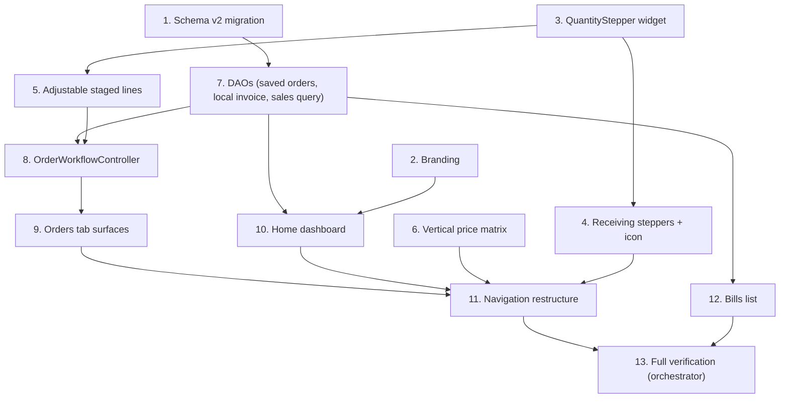

# Implementation Plan: App UX Revamp

## Overview

This plan converts the approved `app-ux-revamp` design into incremental Dart/Flutter steps. It owns the drift schema v1->v2 migration, all presentation/navigation changes, and the two new persisted capabilities (saveable orders, local sales history for the dashboard). It reuses the existing domain/application engines unchanged.

This spec is built in PARALLEL with `supabase-integration` under a strict file-ownership boundary: this spec owns `lib/data/tables.dart`, `lib/data/app_database.dart`, everything under `lib/presentation/**`, `main.dart`, `lib/domain/app_info.dart`, and the new DAO files. It MUST NOT touch the Supabase adapter files, the hosted/auth provider seam, or `supabase/migrations/**`. `pubspec.yaml` is edited by the orchestrator only.

Quick wins land first (migration, branding, stepper, receiving, price matrix), then the persisted capabilities (DAOs, workflow), then the dashboard and navigation restructure.

## Task Dependency Graph



```json
{
  "waves": [
    { "id": 0, "tasks": ["1", "2", "3", "6"] },
    { "id": 1, "tasks": ["1.1", "3.1", "4", "5", "6.1", "7"] },
    { "id": 2, "tasks": ["4.1", "5.1", "7.1", "8"] },
    { "id": 3, "tasks": ["8.1", "9", "10"] },
    { "id": 4, "tasks": ["9.1", "10.1", "12"] },
    { "id": 5, "tasks": ["11", "12.1"] },
    { "id": 6, "tasks": ["13"] }
  ]
}
```

## Tasks

- [x] 1. Schema v2 migration (DraftOrders extensions)
  - Bump `kSchemaVersion` to 2 in `lib/data/app_database.dart`; extend `DraftStatus` with review/approved/sold/shared; add `title`, `updatedAt`, `invoiceId` columns to `DraftOrders`; additive `onUpgrade(1->2)`; regenerate drift codegen.
  - _Requirements: 4.2, 4.4, 8.2_

- [x] 1.1 Migration test (v1 -> v2 preserves data)
  - Seed a v1 DB, upgrade, assert new columns exist and old rows survive.
  - _Requirements: 8.2_

- [x] 2. Branding: name + launcher icon reference
  - Confirm `kAppName` = "CFT Calculator" in `lib/domain/app_info.dart`; reference the brand asset in the dashboard header.
  - _Requirements: 1.1, 1.2, 1.3, 1.4_

- [x] 3. Shared QuantityStepper widget
  - Create `lib/presentation/common/quantity_stepper.dart`: -/value/+ with tap-to-type, clamp >= 0, 44x44 targets, accessible labels + unit.
  - _Requirements: 2.1, 2.3, 2.6, 3.2_

- [x] 3.1 QuantityStepper widget test
  - +/- clamp at zero; tap-to-type parses whole numbers; rejects negative/non-whole.
  - _Requirements: 2.2, 3.4_

- [x] 4. Receiving screen: steppers + icon action
  - Replace per-length text fields with `QuantityStepper`; icon-only "Add to inventory"; keep `ReceivingService` commit + negative-stock guard.
  - _Requirements: 2.1, 2.2, 2.4, 2.5, 2.6_

- [x] 4.1 Receiving widget test (stepper commit)
  - Stepping then activating the icon records the exact entry.
  - _Requirements: 2.5_

- [x] 5. Adjustable staged order lines with exact CFT
  - Render staged lines with exact CFT + `QuantityStepper`; decrement-to-zero removes; footer running total CFT via the shared engine.
  - _Requirements: 3.1, 3.2, 3.3, 3.4, 3.5_

- [x] 5.1 Adjustable-lines widget test
  - Adjusting qty recomputes exact CFT; zero removes the line.
  - _Requirements: 3.3, 3.4_

- [x] 6. Vertical price matrix
  - Rewrite the price-matrix body as a vertical list; preserve providers, missing-rate marker, persistence, 44x44 targets.
  - _Requirements: 5.1, 5.2, 5.3_

- [x] 6.1 Vertical price-matrix widget test
  - Edit/clear persists; missing marker shows; vertical layout.
  - _Requirements: 5.2_

- [x] 7. SavedOrdersDao + LocalInvoiceWriter + SalesQueryDao
  - New DAOs: saved-order create/upsert/resume/status; `FinalizedInvoice` -> `Invoices`/`InvoiceLines` mapping; dashboard aggregates (available stock, totals sold, recent invoices).
  - _Requirements: 4.2, 4.3, 4.5, 6.2, 6.3, 6.4, 6.5_

- [x] 7.1 DAO unit tests
  - Save/resume round-trip; invoice mapping fidelity; aggregates reconcile order-independent.
  - _Requirements: 8.4_

- [x] 8. OrderWorkflowController (unified flow)
  - startNewOrder/addRequest/updateLineQty/removeLine/review/approve/finalizeSold(keyed `order:{draftId}`)/share/saveForLater/resume, composing allocation+billing+finalize+DAOs.
  - _Requirements: 4.1, 4.5, 4.6, 4.7_

- [x] 8.1 Workflow test
  - build->review->approve->sold writes exactly one invoice + flips status; re-sold no-op; save/resume.
  - _Requirements: 4.5, 4.2, 4.3_

- [x] 9. Orders tab surfaces
  - `OrdersHomeScreen` (resumable list + New order); wire OrderBuild -> reuse AllocationReview -> reuse InvoicePreview with Next/Back + Save-for-later.
  - _Requirements: 4.1, 4.3, 7.3_

- [x] 9.1 Orders widget test
  - New order flows forward; saved order appears and resumes.
  - _Requirements: 4.1, 4.3_

- [x] 10. Home dashboard
  - `dashboard_screen.dart`: brand header + top-right Settings gear (pushes existing SettingsTab); available stock, totals sold (count/CFT + INR), recent orders; reads SalesQueryDao.
  - _Requirements: 6.1, 6.2, 6.3, 6.4, 6.6, 6.7, 7.2_

- [x] 10.1 Dashboard widget test
  - Renders seeded aggregates; Settings action present.
  - _Requirements: 6.2, 6.3, 6.4_

- [x] 11. Navigation restructure (Stock/Orders/Home/Bills; Home default; Settings top-right)
  - Rewrite the shell with four tabs + per-tab navigators; Home default; remove Settings bottom tab; update `test/presentation/app_test.dart` as needed.
  - _Requirements: 7.1, 7.2, 7.4, 7.5, 7.6_

- [x] 12. Bills list screen
  - `bills_list_screen.dart`: finalized invoices from local `Invoices`, newest first; tap for read-only detail.
  - _Requirements: 7.5, 6.4_

- [x] 12.1 Bills widget test
  - Seeded invoices listed newest-first.
  - _Requirements: 7.5_

- [x] 13. Full verification (orchestrator-run after merge)
  - `flutter analyze` clean; `flutter test` green; fix cross-spec breakage with supabase-integration.
  - _Requirements: 8.1, 8.2, 8.5_

## Notes

- The underlying domain/application engines and their contracts are unchanged; Correctness Properties 1-31 are inherited and must stay green.
- New presentation surfaces get widget tests; new persisted capabilities get DAO/workflow unit tests (design Properties 32-37).
- All tests run headless on Windows against `openInMemoryDatabase()` and the existing fakes; no live network.
- File-ownership boundary with `supabase-integration` is strict (see Overview); `pubspec.yaml` edits are made by the orchestrator only.
