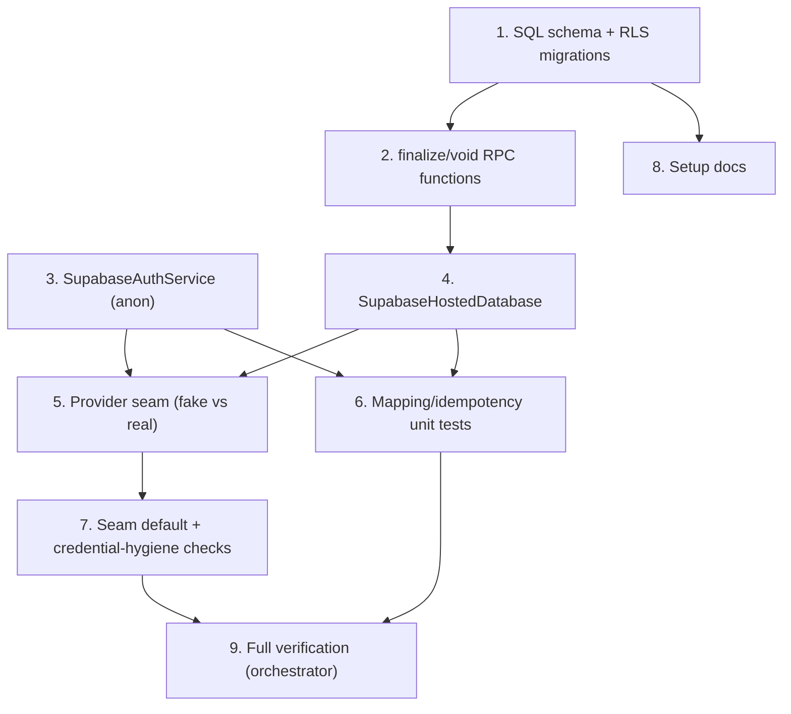

# Implementation Plan: Supabase Integration

## Overview

This plan wires a real Supabase backend behind the existing `HostedDatabase` and `AuthService` interfaces, provisions the Supabase schema + RLS (nothing exists yet), and keeps the in-memory fakes as the default test doubles so `flutter test` stays offline-green on Windows.

Built in PARALLEL with `app-ux-revamp` under a strict file-ownership boundary. This spec owns ONLY: new files `lib/data/supabase_hosted_database.dart`, `lib/application/supabase_auth_service.dart`, `supabase/migrations/**`, `docs/SUPABASE_SETUP.md`, and the provider-seam files `lib/data/hosted_database_providers.dart` + `lib/application/auth_providers.dart`. It MUST NOT touch `lib/data/tables.dart`, `lib/data/app_database.dart`, anything under `lib/presentation/**`, `main.dart`, `lib/domain/app_info.dart`, or `pubspec.yaml`. The `supabase_flutter` dependency is added by the orchestrator before execution.

## Task Dependency Graph



```json
{
  "waves": [
    { "id": 0, "tasks": ["1", "3"] },
    { "id": 1, "tasks": ["2", "8"] },
    { "id": 2, "tasks": ["4"] },
    { "id": 3, "tasks": ["5", "6"] },
    { "id": 4, "tasks": ["7"] },
    { "id": 5, "tasks": ["9"] }
  ]
}
```

## Tasks

- [x] 1. SQL schema + RLS migrations
  - Create committed SQL under `supabase/migrations/`: owner-scoped `catalog_varieties`, `catalog_cross_sections`, `stock_items`, `stock_movements`, `invoices`, `invoice_lines`, `invoice_voids`, `applied_operations` (idempotency_key UNIQUE, confirmed_state jsonb), `sales`, `purchases`; `owner_id uuid default auth.uid()`; RLS enabled with `using (owner_id = auth.uid())`; invoice-number sequence. Re-runnable/versioned. No service-role usage.
  - _Requirements: 4.1, 4.2, 4.3, 4.4, 4.5, 4.6, 4.7, 9.6, 10.6_

- [x] 2. finalize_sale / void_invoice RPC functions
  - Postgres functions performing atomic validate+insert+deduct and the paired `sales`/`purchases` writes, allocating the invoice number inside the transaction; idempotent on idempotency_key; a failed validation commits nothing.
  - _Requirements: 5.1, 5.2, 5.3, 5.4, 9.1, 9.3, 9.4, 10.4, 10.5_

- [x] 3. SupabaseAuthService (non-interactive)
  - `lib/application/supabase_auth_service.dart` implementing `AuthService`: anonymous sign-in on start, `AuthSession.userId` = anon uid, `sessionChanges` from `onAuthStateChange`, `requireSession` throws when no session, SDK auto-refresh. No login UI.
  - _Requirements: 2.1, 2.2, 2.3, 2.4, 2.5, 2.6_

- [x] 4. SupabaseHostedDatabase
  - `lib/data/supabase_hosted_database.dart` implementing `HostedDatabase`: `apply` (idempotent upsert into applied_operations), `runTransaction` (via rpc to finalize_sale/void_invoice), `readConfirmed` (select by key, not-found consistent with fake), error translation to interface exceptions. Session-gated. Also expose an `initializeSupabase()` helper reading URL/anon key from `String.fromEnvironment` (called by main.dart, which the orchestrator wires).
  - _Requirements: 1.2, 1.3, 1.4, 3.1, 3.2, 3.3, 3.4, 3.5, 3.6_

- [x] 5. Provider seam (fake vs real)
  - In `lib/data/hosted_database_providers.dart` and `lib/application/auth_providers.dart`, add a config switch (`bool.fromEnvironment('USE_SUPABASE')`) selecting Supabase impls when configured and the fakes otherwise. Tests/default app resolve the fakes; no test imports the Supabase client.
  - _Requirements: 7.3, 2.*_

- [x] 6. Mapping + idempotency unit tests
  - Unit-test payload/error mapping and the idempotent-replay logic against an injectable Supabase-client stub (no network): same key twice -> one effect, `applied == false` on replay.
  - _Requirements: 3.3, 7.4_

- [x] 7. Seam-default + credential-hygiene verification
  - Test asserting the default (no USE_SUPABASE) resolves to the fakes; re-run the credential-hygiene smoke scan to confirm no anon/service-role key, JWT, or connection string in `lib/`.
  - _Requirements: 7.1, 8.1, 8.2, 8.3, 1.5_

- [x] 8. Setup documentation
  - `docs/SUPABASE_SETUP.md`: the `--dart-define` keys (URL + anon key), how to apply the migrations to the empty project, and the credential rule (never commit a secret / service-role key).
  - _Requirements: 8.4_

- [x] 9. Full verification (orchestrator-run after merge)
  - `flutter analyze` clean; `flutter test` green with the fakes as default; fix cross-spec breakage with app-ux-revamp.
  - _Requirements: 7.1, 7.2, 7.5_

## Notes

- The real Supabase client is wired behind the EXISTING `HostedDatabase`/`AuthService` interfaces; domain/application/presentation contracts do not change.
- Fakes remain the default doubles; headless Windows tests require no network or live Supabase project.
- A live end-to-end finalize against real Supabase is deferred to manual/on-device verification (no live network in CI/Windows).
- File-ownership boundary with `app-ux-revamp` is strict (see Overview); `pubspec.yaml` is orchestrator-owned. Syncing the local sales/purchases model (owned by app-ux-revamp) to the hosted `sales`/`purchases` tables is a later reconciliation pass.
