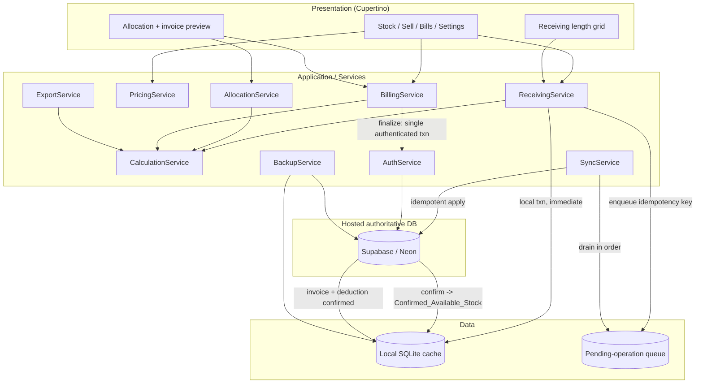
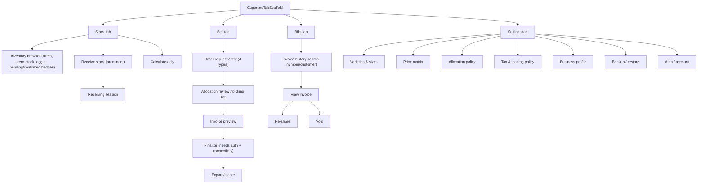
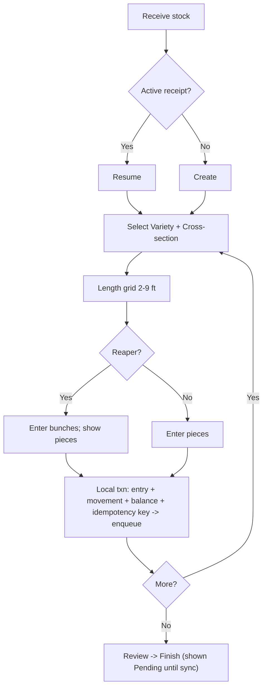
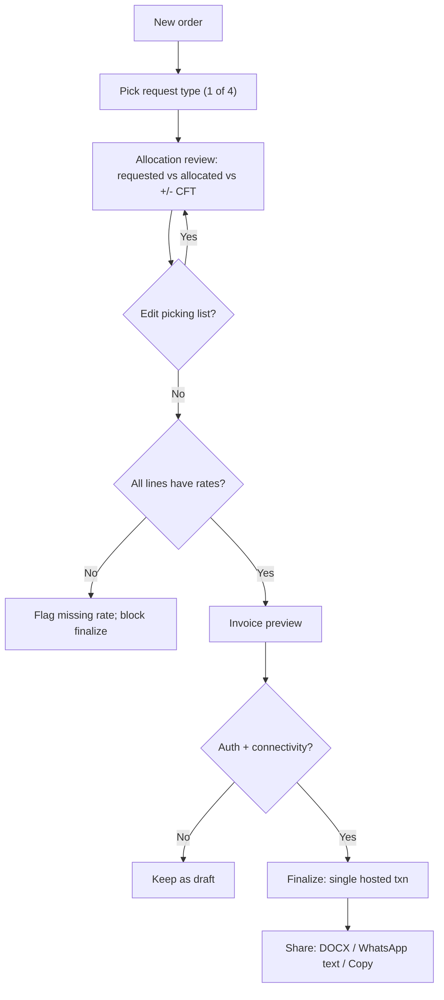
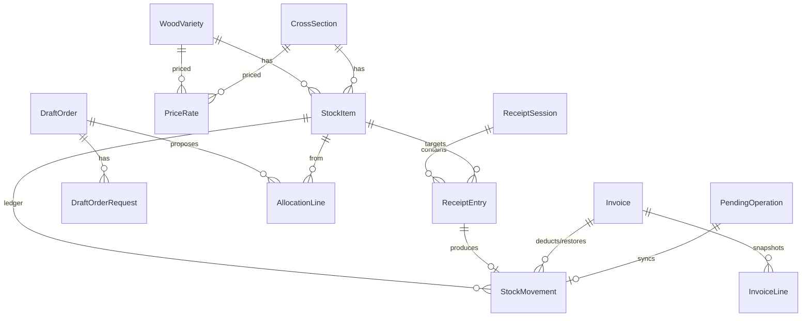

# Design Document

## Overview

Wood CFT is a single-user, single-device Cupertino iPhone application for an owner-operated timber business. Version 1 handles **rectangular timber only** (plywood deferred, CD-8). It manages a product catalog, truck/inventory receiving, a stock-movement ledger, deterministic order allocation, GST-aware billing with exact arithmetic, and invoice export (editable Word document and formatted WhatsApp text).

The authoritative system of record is a **hosted managed database** (Supabase preferred, Neon an allowed alternative — CD-7, Requirement 19). On-device there is a **local SQLite cache** and a **durable pending-operation queue**. Everyday work is **offline-capable**: CFT calculation, cached inventory browsing, receiving entry, and draft editing all function against the local cache and queue without connectivity. **Finalized billing is cloud-confirmed**: it requires an authenticated hosted-database transaction and therefore connectivity. The split means the owner can keep working on a weak signal and only needs the network at the moment a bill becomes a permanent invoice.

### Stack decision

- **Framework:** Flutter stable, pinned to a 3.4x line (target **3.4x**, Dart **3.13.x**). The exact patch and the Flutter/Dart pairing **must be re-verified at implementation time** — these values are a starting point, not a guarantee.
- **UI:** Cupertino (Apple Human Interface Guidelines) native controls (Requirement 17). Restrained neutral theme, single accent color, light/dark, no wood photography.
- **Local cache:** SQLite. Recommendation is **drift** (typed, compile-checked SQL, first-class transaction blocks, generated migrations) over raw **sqflite**. drift's typed DAO layer and `transaction(() async {...})` reduce the chance of a mistyped column silently corrupting money or stock in the ledger/invoice invariants this app depends on. The cost is a build-time generator; for a correctness-critical ledger that cost is worth it. sqflite remains a viable fallback with disciplined manual SQL.
- **Hosted DB client:** Supabase Dart client (anon key + Row Level Security) preferred; Neon reached only through an authenticated API (no direct DB credentials in the app).

> All package and tooling choices (Flutter/Dart SDK, drift/sqflite, Supabase client, DOCX/share packages, macOS CI runner image) **MUST be re-verified at implementation time**. Nothing here asserts any untested dependency or CI step is already verified.

### Requirement-area to component map

| Requirement area | Primary design component |
|---|---|
| R1 Catalog, R4 Pricing | `CatalogService`, `PricingService`, catalog/price tables (local + hosted) |
| R2 CFT, R9 Money | `CalculationService` (single shared engine) |
| R3 Sale units, R8 Allocation, R7 Order entry | `AllocationService` |
| R5 Receiving, R6 Browser | `ReceivingService`, `SyncService`, Stock tab |
| R10 Tax, R11 Loading, R12 Finalization, R13 Void | `BillingService`, `AuthService`, hosted transaction |
| R14 DOCX, R15 WhatsApp | `ExportService` |
| R16 Backup | `BackupService` |
| R17 UI/Accessibility, R18 Business profile | Cupertino presentation layer, settings |
| R19 Data/sync/auth | `SyncService`, `AuthService`, local cache + pending-op queue, hosted DB |
| R20 Build/sideload | GitHub Actions macOS pipeline + Sideloadly docs |
| R21 Acceptance examples | Testing Strategy + domain tests |

### Build / platform constraints that could threaten the Windows + free-account Sideloadly workflow

- **No push notifications, no iCloud, no background services** in core features (19.9). A free Apple account cannot grant those entitlements. The design keeps all core behavior local and user-initiated. Supabase/Neon network calls are plain HTTPS and need no special entitlement, but **finalized billing needs connectivity** by design.
- **7-day signing expiry.** A free account resign cycle (~7 days) means the owner periodically re-signs via Sideloadly; the app must survive reinstall without data loss (local cache + hosted authoritative store + backup/restore cover this).
- **DOCX attachment sharing on a real iPhone** (especially the WhatsApp attachment path) **must be verified on device** and is **not** asserted here as pre-verified.
- **iOS compile requires macOS/Xcode** — not available on Windows — so release builds run on a hosted macOS CI runner. Any package needing an entitlement unavailable to a free account must be flagged in docs (19.8).

---

## Architecture

Layered architecture with a strict inward dependency direction. The **Domain layer is pure Dart with no Flutter and no I/O imports**, so it runs under `flutter test` / `dart test` on the owner's Windows laptop with no iPhone or simulator.

- **Presentation** — Cupertino screens/widgets (tabs, receiving grid, allocation preview, invoice preview, settings). No business logic.
- **Application / Services** — orchestration and state. State management via **Riverpod** (compile-safe, testable; `provider` acceptable if preferred). The individual services are detailed under *Components and Interfaces* below.
- **Domain** — entities, value objects (exact CFT, Money), and policies (allocation, tax, loading). Pure Dart.
- **Data** — local SQLite cache repository, hosted-database client, and the durable pending-operation queue. Transactions live here; the domain defines *what* must be atomic, the data layer enforces it.

### Hosted-DB access and credentials

- **Supabase (preferred):** app ships only the **client-safe anon key**; privileged access is gated by **Row Level Security** keyed to the authenticated owner session (19.4). No service-role key is ever embedded (19.6).
- **Neon (alternative):** the app never holds a direct Postgres connection string; it reaches Neon only through an **authenticated API** (serverless function / backend) that holds credentials server-side (19.5).
- Either way: **no privileged or service-role credentials in the app, source, GitHub, or CI secrets** (19.6, 20.7).

### Component and data-flow diagram



### Offline/online data flow (summary)

1. **Local write → queue → sync → hosted confirm:** a receiving entry commits to the local cache immediately and is enqueued with a stable idempotency key; `SyncService` later applies it to the hosted DB exactly once; on confirmation the quantity flips from `Pending_Receiving_Stock` to `Confirmed_Available_Stock` (19.7–19.10).
2. **Finalize → authenticated hosted transaction:** finalize requires an authenticated session and connectivity, and runs as a single hosted transaction (validate → write invoice snapshots → assign permanent number → deduct stock) that is all-or-nothing and idempotent (12.2, 12.3).

---

## Components and Interfaces

The Application / Services layer orchestrates all domain behavior and state. State management is via **Riverpod** (compile-safe, testable; `provider` acceptable if preferred). Services:

- `CalculationService` — the single shared CFT + money engine.
- `AllocationService` — deterministic bounded heuristic.
- `PricingService` — price matrix lookups, missing-rate detection.
- `ReceivingService` — receipt sessions, immediate local commit, enqueue.
- `BillingService` — subtotal/tax/loading/totals, finalize orchestration.
- `ExportService` — DOCX + WhatsApp text from the invoice snapshot.
- `SyncService` — drains the pending-op queue to the hosted DB, idempotent apply, retry/backoff.
- `AuthService` — authenticated owner session for privileged hosted access.
- `BackupService` — portable export/import with schema/version validation.

The **shared `CalculationService`** is used by receiving (CFT display), stock views (available CFT), allocation (exact CFT per unit), billing (line amounts, totals), and exports (snapshot values). There is exactly one implementation of the CFT and money arithmetic so previews, invoices, DOCX, and WhatsApp text can never disagree.

---

## Screen Flows

### Bottom tabs (17.8)

Four Cupertino bottom tabs: **Stock**, **Sell**, **Bills**, **Settings**.



### Stock tab

- **Inventory browser (Requirement 6):** filter by variety, category, cross-section, length (6.1); show available quantity and available CFT per item with explicit unit labels (6.2, 6.5); totals across the current filter (6.3); show/hide zero-stock toggle (6.4). Each item shows **pending vs confirmed badges** — `Pending_Receiving_Stock` is visibly distinct from `Confirmed_Available_Stock` and is **not sellable** until synced (19.8, 5.6a).
- **Receive Stock** entry is **prominent** on this tab (17.9).
- **Receiving session (Requirement 5):** create a new receipt or resume an active one (5.1, 5.7) → select variety + cross-section, selection stays active across the grid (5.3) → enter quantities on the **compact length grid 2–9 ft** (reapers in bunches with the piece-equivalent shown, planks in pieces — 5.4, 5.5) → each explicit entry **commits immediately** to the local cache in one transaction and is enqueued for sync (5.6) → review → finish. Edits/undo go through validated adjustment/reversal entries (5.11); an undo that would make availability negative is blocked (5.12). An interrupted session is recovered on reopen (5.7, 20.6).
- **Calculate-only (17.10):** pick variety/cross-section/length/quantity, see exact CFT and (if a rate exists) an indicative amount; writes nothing to inventory, drafts, or invoices.



### Sell tab

- **Order request entry (Requirement 7):** structured entry only, no natural-language/AI (7.1). Four request types: exact quantity (7.2); target CFT + exact length (7.3); target CFT + exact cross-section with flexible lengths (7.4); target CFT + category with flexible lengths (7.5). Target direction is always **meet-or-exceed** (round up); no at-most/closest option (7.6, CD-3).
- **Allocation review / picking list:** shows **requested vs allocated vs over/under CFT**, editable; understock is a clearly labeled **partial** proposal with the shortage, never "fulfilled" (8.3, 8.4).
- **Invoice preview:** lines, rates, tax, loading, totals from the shared calculation. A line missing a rate is flagged and **blocks finalize** (4.7, 17.14).
- **Finalize:** requires an **authenticated session and connectivity** (12.2, 12.3b). If either is missing, the order **stays a draft** and the owner is told why.
- **Export/share:** after finalize, produce DOCX, WhatsApp text, or copy text.



### Bills tab

Search finalized invoices by **number or customer** (and date); view; **re-share** DOCX/text generated from the stored snapshot with no re-deduction (15.6); record a **void** that restores stock exactly once (Requirement 13).

### Settings tab

Varieties & sizes (add/rename/deactivate — Requirement 1); **price matrix** (editable grid with visible missing-rate markers — Requirement 4); allocation policy (8–9 ft fallback toggle, reaper shares); tax & loading policy; business profile (Requirement 18); backup & restore (Requirement 16); **auth / account** (sign in for finalize/sync).

### First-run, pricing order, accessibility

- **First-run setup (17.12):** seed catalog (varieties Mahogany/Kalani/Palajathi; cross-sections 2×1 Reaper, 3×1…7×1 Plank — 1.1, 1.2), set all stock to zero, seed no prices or fake stock (1.12); request only the minimum config to begin. Timezone defaults to **Asia/Kolkata** with no setup burden.
- **Receiving allowed before prices (17.13, 4.6);** selling **flags missing prices** (17.14, 4.5).
- **Accessibility (Requirement 17):** touch targets ≥ 44×44 pt (17.3); dynamic type + VoiceOver (17.4); **shortage never conveyed by color alone** (17.5); quantity + CFT always shown with explicit unit labels (17.6); SF Symbols via a supported bridge with a Cupertino fallback, recording availability and the fallback used (17.2).

---

## Data Models

All timestamps are stored in **UTC** and displayed in **Asia/Kolkata** shop local time (no timezone setup burden). Available stock is a **transactionally-maintained balance** that must always equal the signed sum of `StockMovement` rows for that stock item (reconciliation invariant); the balance is a cache of the ledger, and the ledger is the source of truth for history. The schema prevents: **duplicate stock keys** (unique on variety+cross-section+length); **orphan invoice lines** (non-null FK to invoice); **negative availability** (guarded inside the transaction, not just the UI); and **hard-deletion of catalog entities referenced by finalized records** (deactivate, never delete — 1.5, 1.6, 12.7).

### Local cache vs hosted schema

The **local SQLite cache mirrors the hosted schema** and adds **pending flags**. Pending vs confirmed stock is represented two ways that must agree:
- Each `StockMovement` and `PendingOperation` carries a `sync_state` (`Pending` | `Confirmed` | `Failed`).
- Each `StockItem` tracks both `confirmed_balance_pieces` (sum of confirmed movements, the sellable quantity) and `pending_balance_pieces` (sum of not-yet-confirmed received movements, display-only, not sellable — 5.6a, 19.8).

| Entity | Key fields | Notable fields / types |
|---|---|---|
| **WoodVariety** | `id` (PK) | `name` (text, unique while active), `active` (bool), `created_at` (UTC) |
| **CrossSection** | `id` (PK) | `width_in` (int), `thickness_in` (int), `category` (enum Reaper\|Plank), `bunch_size` (int; 10 for Reaper, 1 for Plank), `active` (bool) |
| **StockItem** | `id` (PK); **unique(`variety_id`,`cross_section_id`,`length_ft`)** | `length_ft` (int 2–9), `confirmed_balance_pieces` (int ≥ 0, maintained), `pending_balance_pieces` (int ≥ 0, display-only) |
| **StockMovement** (ledger) | `id` (PK) | `stock_item_id` (FK), `type` (enum Receive\|Opening\|Adjust\|Reverse\|Sale\|Void), `delta_pieces` (signed int, whole pieces), `occurred_at` (UTC), `receipt_entry_id`/`invoice_id` (nullable FK), `reason` (text; required for Adjust/Reverse), `idempotency_key` (text, unique), `sync_state` (enum Pending\|Confirmed\|Failed) |
| **ReceiptSession** | `id` (PK) | `status` (enum Active\|Finished), `started_at`, `finished_at` (UTC, nullable) |
| **ReceiptEntry** | `id` (PK) | `receipt_id` (FK), `stock_item_id` (FK), `qty_input` (int, bunches or pieces), `unit` (enum Bunch\|Piece), `pieces_delta` (int), `idempotency_key` (unique), `created_at` (UTC) |
| **PriceRate** | **unique(`variety_id`,`cross_section_id`)** | `rate_num`,`rate_den` (exact rational ₹/CFT) or integer paise-per-CFT; nullable = missing rate |
| **DraftOrder** | `id` (PK) | `status` (enum Draft\|Preview), `customer_name`/`customer_phone` (nullable), `created_at` (UTC) |
| **DraftOrderRequest** | `id` (PK) | `draft_id` (FK), `request_type` (enum ExactQty\|TargetCftFixedLen\|TargetCftFlexCrossSection\|TargetCftFlexCategory), `variety_id`, `cross_section_id`/`category` (nullable), `length_ft` (nullable), `target_cft_num`/`den` (nullable), `qty` (nullable) |
| **AllocationLine** | `id` (PK) | `draft_id` (FK), `stock_item_id` (FK), `qty_units` (int), `unit` (enum), `pieces` (int), `exact_cft_num`/`den`, `is_partial` (bool), `shortage_pieces` (int) |
| **Invoice** | `id` (PK), `invoice_number` (unique, permanent) | `status` (enum Finalized\|Voided), `customer_name`/`phone` (snapshot), `goods_subtotal_paise`, `tax_paise`, `loading_paise`, `payable_paise`, `total_cft_num`/`den`, `tax_policy_snapshot`, `loading_policy_snapshot`, `business_profile_snapshot`, `finalized_at` (UTC), `idempotency_key` (unique) |
| **InvoiceLine** (immutable snapshot) | `id` (PK) | `invoice_id` (FK **not null** — no orphans), `variety_name` (text snapshot), `cross_section_label` (text snapshot), `length_ft`, `pieces`, `exact_cft_num`/`den`, `rate_num`/`den` (snapshot), `line_amount_paise` (rounded half-up) |
| **BusinessSettings** | singleton | `name`, `address`, `phone`, `logo` (nullable blob), `gstin` (nullable), `invoice_prefix`, tax-invoice fields (nullable) |
| **AllocationPolicy** | singleton | `allow_8_9ft_fallback` (bool, default false), reaper group shares (60/30/10, configurable) |
| **TaxPolicy** | singleton | `mode` (enum NoGst\|Nine\|Eighteen), `rate_num`/`den`, `label` (text) |
| **LoadingPolicy** | singleton | `low_paise` (=10000), `high_paise` (=15000), `threshold_cft` (=20), `threshold_inclusive` (bool, default true) |
| **PendingOperation** (queue) | `id` (PK) | `op_type` (enum ReceiveEntry\|Adjust\|Finalize\|Void), `payload` (serialized), `idempotency_key` (unique), `enqueued_at` (UTC), `attempts` (int), `sync_state` (enum Pending\|Confirmed\|Failed), `last_error` (text, nullable) |
| **BackupMeta** | — | `schema_version` (int), `app_version`, `exported_at` (UTC), `checksum` |



---

## CFT and Currency Arithmetic

### Exact rational volume (Requirement 2)

CFT is represented as an **exact rational** (big-integer `numerator`/`denominator`, e.g. Dart `package:rational`) or an equivalent scaled-integer — **never a binary `double`** — to avoid floating-point drift. The concrete Dart approach is a `Cft` value object wrapping a `Rational`; **mark as to-be-verified** against the chosen package at implementation.

- `CFT_per_piece = width_in × thickness_in × length_ft / 144` (divisor **144**, never 1728 — 2.1, 2.2)
- Bunch CFT `= CFT_per_piece × 10` (2.3)
- Line CFT `= CFT_per_piece × piece_qty` (2.4)
- Total CFT `= Σ (exact unrounded line CFT)` (2.5, 9.6)

CFT display is **4 decimal places and display-only**; the displayed value never alters stored exact CFT, allocation outcomes, loading-tier comparison, or money (2.6, 2.7).

**Worked examples (Requirement 21):**
- 2×1 at 6 ft: `2·1·6/144 = 1/12 = 0.0833` (21.1)
- One bunch 2×1 at 6 ft: `(1/12)·10 = 5/6 = 0.8333` (21.2)
- 5 bunches 2×1 at 2 ft: `(2·1·2/144)·50 = 25/18 = 1.3889` (21.3)
- 12 pieces 3×1 at 8 ft: `(3·1·8/144)·12 = 2.0000` exactly (21.4)
- 3 bunches Mahogany 2×1 at 6 ft: 30 pieces, `(5/6)·3 = 2.5` CFT (21.5)

### Currency (Requirements 9, 10, 11)

Money uses **decimal or rational arithmetic** — a `Money` value object over integer **paise** (or `package:decimal`), never binary float. Concrete choice **to-be-verified** at implementation.

1. `line_amount = exact_CFT × rate` in decimal/rational (9.1).
2. **Round each line half-up to paise** (9.2).
3. `goods_subtotal = Σ (rounded line amounts)` (9.3).
4. `taxable_subtotal = goods_subtotal` (loading excluded); `tax = taxable_subtotal × literal_rate` (9.4, 10.3, 10.4).
5. `loading` added **after tax**: ₹100 when exact total sold CFT `< 20`, ₹150 when `>= 20` (**exactly 20 → ₹150**) — compared on exact CFT, never display-rounded (11.1–11.3, 11.5).
6. `grand_total (payable) = goods_subtotal + tax + loading`.
7. Display INR with **2 dp and Indian digit grouping** (9.5). **No whole-rupee rounding** (OD-8); if ever requested, show a separate round-off line.

**Synthetic billing checks:**
- 50 pieces billed at ₹1200/CFT, No GST → goods `₹1,666.67`; loading ₹100 (order < 20 CFT) → payable `₹1,766.67` (21.8).
- Goods ₹1,000 + loading ₹100 at literal 18%, loading untaxed → tax `₹180`, payable `₹1,280` (21.18).
- Target 5 CFT of 2×1 at 7 ft: 5 bunches = `4.8611` CFT, 6 bunches = `5.8333` CFT; meet-or-exceed selects 6 bunches (21.10).

**Reconciliation note:** because each line is rounded half-up independently before summing, the sum of displayed line amounts can differ by a paise or two from `(Σ exact line values)` rounded once. The authoritative figure is the **sum of independently-rounded line amounts** (9.3); any aggregate display derives from that. Documented so the owner understands small expected rounding differences.

---

## Allocation Behavior

`AllocationService` is a **bounded heuristic — explicitly NOT an optimal solver** (8.12). It is deterministic: identical inputs (request + stock snapshot + policy) always produce identical output (21.11 repeatability).

### Hard constraints (never violated) — 8.1

- Length restriction (fixed-length requests use only that length; a fixed-length request that cannot be met does **not** silently mix other lengths — 21.12).
- Cross-section / category restriction.
- Whole-unit rule: Reaper in multiples of 10 pieces (bunches), Plank in whole pieces.
- Stock availability (allocated pieces ≤ available; **no silent reduction** — 8.3).

### Target handling — meet-or-exceed only

Meet-or-exceed (round up) is the **only** direction; there is no at-most or closest option (7.6, CD-3). For a single eligible SKU:

```
required_units = ceil(requested_CFT / CFT_per_sale_unit)   // exact arithmetic
```

where a sale unit is a complete **bunch** for reapers and a whole **piece** for planks (8.2). The ceiling applies to **unit counts, not money**. Billing always uses **actual allocated CFT**, never the requested target (8.5).

### Flexible reaper length-share heuristic (8.8, 8.9, 8.10, CD-4)

Shares apply to **allocated CFT** across length groups: `{6,7} = 60%`, `{3,4,5} = 30%`, `{2} = 10%`. **8–9 ft excluded by default** (available only for explicit-length/manual allocation, or when the fallback policy is enabled — 8.9, OD-5). Shares are **approximate and stock-aware**, not an exact integer-bunch guarantee (8.8).

```text
function allocateFlexibleReaper(targetCft, stockByLength, policy):
  groups = [ {lengths:[6,7], share:0.60},
             {lengths:[3,4,5], share:0.30},
             {lengths:[2],     share:0.10} ]
  exclude lengths {8,9} unless policy.allow_8_9ft_fallback
  remaining = targetCft
  allocated = {}
  for g in groups (fixed order 60 -> 30 -> 10):
     groupTarget = targetCft * g.share
     for len in sortByTieBreak(g.lengths):      # lower length first
        unitCft = cftPerBunch(crossSection, len) # exact rational
        want    = ceilUnits(groupTargetRemaining / unitCft)   # meet-or-exceed
        take    = min(want, availableBunches(len))
        allocate(len, take)
        reduce groupTargetRemaining and remaining by take*unitCft
  # preferred-group shortfall: redistribute the deficit among the OTHER
  # eligible groups and recompute (keeps result stock-aware)
  if anyGroupShort:
     redistributeDeficitAmongEligibleGroups()
     recompute()
  assert every allocated reaper quantity is a multiple of 10 pieces  # whole-unit
  if remaining > 0 (stock exhausted):
     mark partial with shortage          # 8.4 — never labeled fulfilled
  return allocated
```

### Deterministic objective order (8.7)

1. Enforce **hard constraints**.
2. **Meet or exceed** the target, **minimizing the excess CFT**.
3. **Minimize deviation** from the preferred length-group shares.
4. **Stable tie-breaker:** lower `Length_Ft`, then lower `StockItem` id.

### Multi-line and understock

- **Multi-line:** each line allocates against the **remaining** availability so no stock quantity is counted twice (8.6, 21.14).
- **Understock:** a clearly labeled **partial** proposal stating the shortage; never labeled fulfilled (8.4).

### Flexible plank (8.11, OD-4)

Planks use **whole pieces**, round up to meet or exceed the target while minimizing excess CFT, apply the same stable tie-breaker, and **do NOT use reaper length-group shares/weights** (8.10, 21.13).

### Worked examples

- Target 5 CFT of 2×1 at **6 ft** → 6 bunches (meet-or-exceed; 60 pieces) (21.9).
- Target 5 CFT of 2×1 at **7 ft** → 5 bunches = `4.8611` CFT, 6 bunches = `5.8333` CFT; pick **6** (21.10).
- Flexible reaper group tests: abundance, preferred-share shortage, absence of 2 ft stock, total shortage — each produces whole bunches, excludes 8–9 ft, and repeats to the same result (21.11).

### Stated limitations

The heuristic is greedy and group-ordered. It may not find the global minimum-excess combination across all lengths, may leave small remainders when whole-unit granularity is coarse, and treats the 60/30/10 shares as approximate rather than guaranteed. No exhaustive enumeration is performed. These limitations are intentional and documented; the system **does not claim optimality** (8.12).

---

## Transaction Boundaries & Sync

Operations are split into **local-only** (work offline against the cache + queue) and **hosted-transactional** (require an authenticated hosted transaction). Each boundary below is atomic within its own store — all writes commit or none do.

### Local-only operations

**(a) Receiving entry.** Within one **local SQLite transaction** (immediate): insert `ReceiptEntry`; insert a `StockMovement` (type Receive/Opening, signed `delta_pieces`, `sync_state = Pending`); increment `StockItem.pending_balance_pieces`; **enqueue a `PendingOperation`** with a stable `idempotency_key` (5.6, 19.7). The quantity is shown as `Pending_Receiving_Stock` and **not sellable** until sync confirms it (5.6a, 19.8). Repeating the same key (retry, double-tap, resume, finish) is a no-op — stock is added exactly once (5.8, 5.9, 21.6).

**(b) Adjustment / reversal with negative-stock guard.** Within one local transaction: compute the resulting balance; **if it would be negative, abort the whole transaction** and surface a blocking error (5.12, 21.19). Otherwise insert the `Adjust`/`Reverse` movement (with required `reason`), update the balance, record the key, and enqueue for sync.

**(c) Draft / preview / calculate.** **No stock mutation anywhere** — local or hosted (12.1, 12.5, 21.21). Drafts never reserve stock.

### Hosted-transactional operations

**(d) Finalize sale (all-or-nothing).** Requires an **authenticated session and connectivity** (12.2). If either is missing, the order **stays a draft** and finalize is refused — receiving, calculation, and draft editing remain available offline (12.3b). When connected, a **single authenticated hosted-database transaction**, in order:
1. **Revalidate** `Confirmed_Available_Stock` and that every sold line has a valid rate (12.6, 4.7).
2. Write the `Invoice` row and the **immutable `InvoiceLine` snapshots**.
3. **Allocate the permanent invoice number only inside this transaction** (a rolled-back attempt never consumes a number; **gaps from rolled-back attempts are acceptable** — 12.4).
4. **Deduct stock** via confirmed `Sale` movements and balance updates.
5. Record the finalize `idempotency_key`.

Repeating finalize with the same key yields **exactly one invoice and one deduction** (12.3, 21.7, 21.20). When a finalize response is **lost or times out**, the client **retries with the same key**, so a lost response cannot create a duplicate invoice or deduction (12.3a, 21.26). On transaction failure, stock and invoice numbering stay consistent with the pre-finalization state (12.4).

**(e) Void.** Within one hosted transaction: mark the `Invoice` Voided (original **retained, never deleted** — 13.2); insert `Void` movements that restore the exact pieces previously deducted; update balances; record the void `idempotency_key`. Retried voids restore stock **exactly once** (13.3, 21.23).

**(f) Backup restore.** Validate backup **schema and version** before any write (16.4); import rows preserving movement identity so **no stock movement is duplicated** (16.5, 21.25). On validation failure, abort with no partial writes.

### Sync engine

- The pending-op **queue drains in enqueue order**; each operation is applied with its `idempotency_key` so a retried or duplicated op is applied **exactly once** in the hosted DB (19.9).
- **Uncertain outcome** (lost response / timeout) → **retry with the same key** and **do not create duplicate movements** (19.10, 21.26). Retries use **exponential backoff**.
- On successful hosted confirmation, the corresponding `StockMovement`/`PendingOperation` flips `sync_state` from `Pending` to `Confirmed`, and the stock shifts from `pending_balance_pieces` to `confirmed_balance_pieces` (sellable).
- **Conflict handling (single-user, single-device):** because there is one device, the device's queue is the only writer of its pending ops; last-writer-within-one-device applies. **Multi-device concurrency is out of scope for v1** and explicitly noted as a non-goal.
- **Invoice-number allocation** is a hosted-side **sequence** assigned inside the finalize transaction; rolled-back attempts leave gaps, which are acceptable (12.4).
- **Queued receiving ops that fail server validation** are marked `sync_state = Failed` with `last_error`, surfaced to the owner, and the corresponding `pending_balance_pieces` is **not** promoted to confirmed. The owner can correct and re-enqueue (e.g. an opening-stock entry that references a deactivated catalog item). Failed ops never silently vanish and never partially apply.

---

## Export Strategy

### Word document (.docx) — Requirement 14

- Produce a **genuine OOXML `.docx`** in the Flutter/Dart runtime. Candidate: **`docx_template`** (fill a bundled `.docx` template asset), with an **alternative** programmatic OOXML builder (assemble `word/document.xml` + the required OOXML parts/zip structure) if templating proves limiting. Package choice **to-be-verified**.
- A renamed text/HTML file is **NOT acceptable**; PDF-only does **NOT** satisfy the Word requirement (14.2).
- Generated from the **same persisted `Invoice_Snapshot`** as the preview and the WhatsApp text, so all three match exactly (14.3, 15.3).
- Contents: business header, invoice-and-customer block, item table, totals (14.4). **Multi-page item table repeats the header on each page** (14.5).
- Human-readable filename, e.g. `Invoice_<prefix><number>_<customer>.docx` (14.6).
- Shared via the **iOS share sheet** and exportable to the **Files app** (candidate `share_plus` + `path_provider`) (14.7).

> Real-iPhone DOCX **attachment** sharing (especially the WhatsApp attachment path) **MUST be verified on a physical device** and is **NOT asserted as pre-verified** here (21.24).

### WhatsApp text — Requirement 15

Plain formatted text from the same snapshot (15.1, 15.3): simple **headings, line breaks, WhatsApp emphasis** (`*bold*`), **no Markdown tables** (15.2). Example structure:

```
*WOOD CFT TIMBERS*
<address line>  |  Ph: <phone>

Invoice: <prefix><number>
Date: <dd-mm-yyyy>
Customer: <name>  <phone>

----------------------------
Mahogany 2 x 1 in, 6 ft
  30 pcs (3 bunches)  2.5000 CFT  @ ₹1200  = ₹3,000.00
3 x 1 in, 8 ft
  12 pcs  2.0000 CFT  @ ₹1000  = ₹2,000.00
----------------------------
Goods subtotal: ₹5,000.00
Tax (18%):      ₹900.00
Loading:        ₹150.00
*Payable:       ₹6,050.00*
```

Actions: **Share invoice file**, **Share bill text**, **Copy bill text** (15.4), via the iOS share sheet; **generic iOS share sheet fallback** when WhatsApp is absent (15.5). Sharing never re-deducts stock (15.6).

### PDF

PDF is an **optional extra only** and must not replace DOCX or WhatsApp text (15.7).

---

## Windows-to-iPhone Build Path (Requirement 20)

### On Windows (owner's machine)

- Source editing.
- **Pure-Dart domain tests** via `flutter test` (domain layer only — not iPhone validation).
- A **supported local preview** (e.g. desktop/web run) for layout feedback — explicitly **NOT iPhone validation** (20.1).

### iOS compile (requires macOS/Xcode) — GitHub Actions

iOS release builds require macOS/Xcode, so compilation runs in **GitHub Actions on a supported macOS runner** (e.g. `macos-14` / `macos-15`, **verify availability**): checkout → install the **pinned stable Flutter SDK** → `flutter pub get` → `flutter analyze` + `flutter test` → `flutter build ios --release --no-codesign` → package `Build/Products/Release-iphoneos/Runner.app` into `Payload/Runner.app` → zip to an **unsigned `.ipa`** → upload as a downloadable workflow **artifact** (20.2–20.4). A simulator `.app` is **not acceptable**; the deliverable must run independently of a dev server (20.5).

> Exact commands, output paths, and runner image labels **must be verified** against the pinned SDK at implementation time.

```yaml
# TO-BE-VERIFIED sketch — do not treat versions/paths as confirmed
name: build-ios-ipa
on: [workflow_dispatch]
jobs:
  build:
    runs-on: macos-15               # verify runner image availability
    steps:
      - uses: actions/checkout@v4
      - uses: subosito/flutter-action@v2
        with:
          flutter-version: '3.4x'   # verify exact patch + Dart pairing
          channel: stable
      - run: flutter pub get
      - run: flutter analyze
      - run: flutter test                        # domain + widget tests
      - run: flutter build ios --release --no-codesign
      - name: Package unsigned IPA
        run: |
          mkdir -p Payload
          cp -R build/ios/iphoneos/Runner.app Payload/Runner.app   # verify path
          zip -r Runner.ipa Payload
      - uses: actions/upload-artifact@v4
        with:
          name: Runner-ipa
          path: Runner.ipa
```

### Sideloading (documentation — 20.6)

The owner downloads the unsigned IPA to Windows and signs/installs it with **Sideloadly** using a **free Apple account**. Document: the **7-day signing expiry** and refresh procedure; **device trust**; and enabling **Developer Mode** (per the installed iOS version). **Apple credentials stay local — never in source, GitHub, or CI secrets** (20.7).

### Free-account entitlement constraints (20.8, 20.9)

A free Apple account cannot use push notifications, iCloud, or background services, enforces a ~7-day resign cycle, and limits sideloaded apps and device registrations. The **core features (inventory, CFT, local storage, export, user-initiated share) must not depend on any of those** (20.9). Supabase/Neon network calls are plain HTTPS and need no special entitlement, but **finalized billing requires connectivity** by design. Any package feature needing an entitlement unavailable to a free account **must be identified in the documentation** (20.8).

---

## Correctness Properties

*A property is a characteristic or behavior that should hold true across all valid executions of a system — essentially, a formal statement about what the system should do. Properties serve as the bridge between human-readable specifications and machine-verifiable correctness guarantees.*

This feature **supports property-based testing**: the CFT engine, money arithmetic, tax/loading policy, allocation heuristic, idempotency, pending/confirmed accounting, export consistency, and backup round-trip are all pure logic (or logic testable with an in-memory store) with universal properties over a large input space. Infrastructure-bound acceptance criteria — hosted-transaction atomicity (12.2, 12.4), the iOS share sheet / WhatsApp presence (14.7, 15.5), RLS/auth gating (19.3), credential hygiene (19.6), and the build/sideload pipeline (Requirement 20) — are **not** property-tested; they are covered by integration and smoke tests in the Testing Strategy.

Each property below is universally quantified and traces to the requirements it validates.

### Property 1: Exact CFT formula

*For all* valid cross-sections (`width_in`, `thickness_in`) and lengths `length_ft` in 2..9, `CFT_per_piece` equals the exact rational `(width_in × thickness_in × length_ft) / 144`, using divisor 144 (never 1728).

**Validates: Requirements 2.1, 2.2**

### Property 2: Unit scaling (bunch and line) is exact multiplication

*For all* pieces and whole quantities `q`, line CFT equals `CFT_per_piece × q` exactly, and bunch CFT equals `CFT_per_piece × 10` exactly.

**Validates: Requirements 2.3, 2.4**

### Property 3: Total CFT is the exact order-independent sum of line CFT

*For all* finite lists of allocated lines, the total CFT equals the sum of the exact unrounded per-line CFT values, and the result is independent of summation order (sum-of-exact equals exact-of-sum).

**Validates: Requirements 2.5, 9.6**

### Property 4: Display rounding never alters computation

*For all* CFT values, formatting the value to 4 decimal places for display does not change the stored exact value or any downstream allocation outcome, loading-tier comparison, or monetary result computed from it.

**Validates: Requirements 2.6, 2.7**

### Property 5: Whole-unit invariant for sale quantities

*For all* allocation results, every reaper quantity is a whole multiple of 10 pieces (never loose pieces) and every plank quantity is a non-negative whole number of pieces; a reaper quantity entered as bunches displays an equivalent piece count of `bunches × 10`.

**Validates: Requirements 3.1, 3.2, 3.3, 3.4, 8.8**

### Property 6: Meet-or-exceed single-SKU unit count

*For all* positive target CFT values and positive per-sale-unit CFT values, when stock is sufficient the allocated unit count for a single eligible SKU equals `ceil(target_CFT / CFT_per_sale_unit)` using exact arithmetic, and the resulting allocated CFT is the smallest whole-unit allocation that is greater than or equal to the target.

**Validates: Requirements 7.6, 8.2**

### Property 7: Hard constraints are never violated

*For all* order requests and stock snapshots, every line in the allocation result respects all hard constraints: it uses only an allowed length and cross-section/category, satisfies the whole-unit rule, and allocates no more than the available stock for its stock item.

**Validates: Requirements 8.1**

### Property 8: Allocation honesty (no silent reduction; partial labeled with shortage)

*For all* order requests, the allocation is either fully satisfied or clearly labeled partial with a shortage equal to `demand − allocated`; it is never silently reduced and a partial result is never labeled fulfilled.

**Validates: Requirements 8.3, 8.4**

### Property 9: Billing uses actual allocated CFT

*For all* target-CFT order requests, the billed total CFT equals the sum of the exact allocated line CFT values, independent of the requested target CFT.

**Validates: Requirements 8.5**

### Property 10: Multi-line allocation never double-counts stock

*For all* multi-line order requests, the total pieces allocated from any single stock item across all lines does not exceed that stock item's available quantity.

**Validates: Requirements 8.6, 21.14**

### Property 11: Allocation is deterministic with a stable tie-breaker

*For all* order requests and stock snapshots, running the allocation twice yields an identical result, and ties are resolved deterministically by lower `Length_Ft` first, then lower `StockItem` identifier.

**Validates: Requirements 8.7, 8.12, 21.11**

### Property 12: Flexible reaper excludes 8–9 ft and never applies reaper weights to planks

*For all* flexible reaper requests with the fallback disabled, no 8 ft or 9 ft length is used and all allocations are whole bunches; and *for all* plank requests, the reaper length-group shares are never applied.

**Validates: Requirements 8.9, 8.10, 21.13**

### Property 13: Flexible plank uses whole pieces with minimal meet-or-exceed excess

*For all* flexible-length plank requests with sufficient stock, the allocation uses whole pieces, is greater than or equal to the target, and has the smallest excess CFT achievable among whole-piece options, with ties resolved by lower `Length_Ft` then lower `StockItem` identifier.

**Validates: Requirements 8.11**

### Property 14: Line amount is exact before half-up rounding, and goods subtotal sums rounded lines

*For all* lines, the pre-rounding line amount equals the exact product `exact_CFT × rate`; each line amount is then rounded half-up to paise; and the goods subtotal equals the sum of the independently rounded line amounts.

**Validates: Requirements 9.1, 9.2, 9.3**

### Property 15: Single-line literal tax on the taxable subtotal

*For all* taxable subtotals and tax modes in {No GST, 9%, 18%}, the computed tax equals `taxable_subtotal × literal_rate` (zero for No GST), presented as exactly one tax line (never split into CGST/SGST).

**Validates: Requirements 10.1, 10.2, 10.3, 10.5**

### Property 16: Loading is excluded from tax, added once after tax

*For all* orders, the taxable subtotal equals the goods subtotal (loading excluded), exactly one loading charge is applied, and the payable equals `goods_subtotal + tax + loading`; loading is applied even in No-GST mode.

**Validates: Requirements 9.4, 10.4, 11.4, 11.5, 11.6**

### Property 17: Loading tier is a step function on exact CFT at 20

*For all* orders, the loading charge is ₹100 when the exact total sold CFT is less than 20 and ₹150 when it is greater than or equal to 20 (exactly 20 yields ₹150), compared on the exact CFT value and never on the display-rounded value.

**Validates: Requirements 11.1, 11.2, 11.3**

### Property 18: Non-finalizing actions never mutate stock

*For all* sequences of calculate-only, draft-editing, preview, and export/share actions, the stock balances before and after are identical (no stock is deducted or restored).

**Validates: Requirements 12.1, 12.5, 15.6, 21.21**

### Property 19: Operation application is idempotent under a repeated idempotency key

*For all* operations of type receive, finalize, void, or sync, applying the operation any number of times with the same idempotency key produces exactly the same resulting state as applying it once (exactly one stock effect, and for finalize exactly one invoice), including when a lost or duplicated response triggers a retry with the same key.

**Validates: Requirements 5.9, 12.3, 13.3, 19.9, 19.10, 21.7, 21.26**

### Property 20: Negative-availability adjustments are rejected without side effects

*For all* current balances `b` and adjustment/reversal deltas `d` such that `b + d < 0`, the operation is rejected and the balance remains `b` unchanged.

**Validates: Requirements 5.12, 21.19**

### Property 21: Only confirmed stock is sellable

*For all* mixes of pending (unconfirmed) and confirmed stock movements, the sellable (confirmed) availability used by allocation and finalize equals the signed sum of confirmed movements only; pending received quantity is excluded until synchronization confirms it.

**Validates: Requirements 5.6, 19.8, 21.27**

### Property 22: Balance reconciles with the movement ledger

*For all* stock items, the maintained confirmed balance equals the signed sum of that item's confirmed `StockMovement` deltas, and the pending balance equals the signed sum of its pending received deltas.

**Validates: Requirements 5.13, 6.2**

### Property 23: Inventory totals equal the sum over the active filter

*For all* inventories and filter selections, the displayed total CFT equals the sum of the exact available CFT of exactly the items that pass the filter.

**Validates: Requirements 6.1, 6.3**

### Property 24: Finalized invoice snapshots are immutable to later changes

*For all* finalized invoices, mutating rates, catalog entries, tax policy, or loading policy afterward does not change the stored invoice snapshot values.

**Validates: Requirements 4.8, 4.9, 12.7, 21.22**

### Property 25: Void restores exactly the deducted stock and retains the original

*For all* finalized invoices, recording a void restores exactly the pieces previously deducted (exactly once, even if retried with the same key) and the original invoice is retained and marked Voided rather than deleted.

**Validates: Requirements 13.1, 13.2, 21.23**

### Property 26: Missing rate blocks finalization

*For all* orders containing at least one sold line without a valid rate, finalization is blocked.

**Validates: Requirements 4.7, 21.15**

### Property 27: Export outputs are consistent with the snapshot

*For all* finalized invoice snapshots, the monetary and CFT values appearing in the DOCX, the invoice preview, and the WhatsApp text are all equal to the stored snapshot values, and the WhatsApp text contains no Markdown table syntax.

**Validates: Requirements 14.3, 15.1, 15.2, 15.3**

### Property 28: Exported DOCX is a valid OOXML package

*For all* finalized invoice snapshots, the exported Word document is a valid OOXML package (a zip containing at least `[Content_Types].xml` and `word/document.xml`), not a renamed text/HTML file and not a PDF.

**Validates: Requirements 14.1, 14.2**

### Property 29: Backup/restore round-trip preserves data without duplication

*For all* datasets, restoring a backup produced from that dataset preserves every stock balance and every invoice identity exactly, introduces no duplicate stock movement, and rejects a backup whose schema version or structure is invalid without writing anything.

**Validates: Requirements 16.1, 16.4, 16.5, 21.25**

### Property 30: Offline durability across restart

*For all* sequences of offline receiving entries and draft edits, reloading state from the local store (simulated restart) yields identical receipt entries, drafts, and pending-operation queue contents with no data loss, while finalization remains blocked until connectivity and an authenticated session are available.

**Validates: Requirements 19.11, 21.25**

### Property 31: Incomplete statutory fields prevent a verified tax-invoice presentation

*For all* business settings missing required tax-invoice statutory fields, the produced bill is presented as a simple sales bill and never as a verified compliant tax invoice.

**Validates: Requirements 18.6**

---

## Error Handling

- **Input validation (reject, keep editable):** reject non-integer or out-of-range dimensions, lengths outside 2–9 ft, non-positive quantities, fractional pieces, fractional/partial bunches for reapers, and non-finite numeric input. Empty inputs stay **editable without committing** any invalid stock — the system never writes an invalid movement to satisfy a half-typed field.
- **Negative-availability guard:** adjustments/reversals/sales that would drive a balance below zero abort the whole transaction and surface a blocking message (Property 20; 5.12, 21.19).
- **Transaction failure / rollback:** local and hosted transactions are all-or-nothing. A failed finalize leaves stock and invoice numbering consistent with the pre-finalization state (12.4); rolled-back invoice-number attempts leave acceptable gaps.
- **Sync failures / retries / offline finalize block:** queued operations retry with the same idempotency key under exponential backoff; uncertain outcomes never create duplicates (Property 19). Operations that fail server validation are marked `Failed` with `last_error`, surfaced to the owner, and never promoted to confirmed. Finalize is **refused offline or without a session** and the order stays a draft, with a clear reason (12.3b).
- **Export failures:** if DOCX/WhatsApp generation or sharing fails, the **finalized invoice remains available** for retry (no state is lost); generation reads only the immutable snapshot, so retries are safe and deterministic.
- **Auth failures:** a privileged hosted action without a valid session is rejected before any write; the owner is prompted to sign in; draft/receiving/calculate work continues offline.
- **Backup/restore errors:** restore validates **schema and version first** and aborts on mismatch or corruption with no partial writes, and never duplicates a stock movement (Property 29; 16.4, 16.5).

---

## Testing Strategy

### Dual approach

- **Property-based tests** verify the universal properties above across many generated inputs.
- **Unit/example tests** pin the concrete Requirement-21 numbers and specific edge cases.
- **Integration tests** cover the hosted-transaction, auth/RLS, and share-sheet behaviors that are not pure logic.
- **Manual on-device tests** cover what cannot be automated off-device.

### Property-based testing

- Use an established Dart PBT library (candidate: a Dart QuickCheck-style generator package); **do not implement PBT from scratch**. Library choice **to-be-verified** at implementation.
- Each property test runs a **minimum of 100 iterations**.
- Each property test is tagged referencing its design property, format: **Feature: wood-cft-app, Property {number}: {property_text}**.
- Each correctness property (1–31) is implemented by a **single** property-based test. The CFT engine (Properties 1–4), allocation invariants (Properties 5–13), money/tax/loading (Properties 14–17), idempotency (Property 19), pending/confirmed and ledger reconciliation (Properties 21–22), export consistency (Property 27), and backup round-trip (Property 29) are the highest-value targets. Idempotency, finalize, void, and sync properties run against an **in-memory/mocked store** so 100+ iterations are cheap.

### Unit / example tests (Requirement 21 acceptance examples)

Pin exact numbers: CFT `0.0833` (21.1), `0.8333` (21.2), `1.3889` (21.3), `2.0000` (21.4), 3 bunches → 30 pcs / `2.5` CFT (21.5); billing goods `₹1,666.67` / payable `₹1,766.67` (21.8), tax `₹180` / payable `₹1,280` (21.18); allocation 5 CFT @6 ft → 6 bunches (21.9), 5 CFT @7 ft → 6 bunches with `4.8611`/`5.8333` (21.10); loading tiers just below / exactly / just above 20 CFT (21.16); tax totals for No GST / 9% / 18% (21.17); fixed-length cannot be met → no silent mixing (21.12); flexible plank → no reaper shares (21.13); multi-line → no reuse (21.14); missing stock/rate → block finalize (21.15); undo to negative → blocked (21.19).

### Integration tests (not PBT)

- **Finalize atomicity (12.2, 12.4):** against the hosted DB (or a transactional test double), inject a mid-transaction failure and assert no partial writes and consistent pre-state (21.20).
- **Auth/RLS (19.3, 19.4, 19.5):** privileged hosted op without a session is rejected; with a session succeeds; Neon reached only through the authenticated API.
- **Sync end-to-end:** enqueue, drain, confirm; simulate lost response and verify exactly-once (complements Property 19).

### Smoke / static checks

- **Credential hygiene (19.6, 20.7):** static check that no service-role/privileged key appears in the app bundle, source, or CI config.
- **First-run seed (1.1, 1.2, 1.12):** app launches with the seeded catalog, zero stock, and no seeded prices.

### Manual on-device tests — MUST be actually performed

The following **must be executed on a physical iPhone and must not be reported as passed unless actually run**:

- **iOS build + sideload (Requirement 20):** CI produces an unsigned IPA artifact; the owner sideloads it with Sideloadly on a free Apple account and the app launches and runs independent of a dev server (20.5, 20.6).
- **DOCX attachment sharing (14.1, 14.7, 21.24):** export a real invoice as `.docx`, share it through the iOS share sheet, and **confirm it opens as an editable Word document** and attaches correctly in **WhatsApp**; verify multi-page header repetition on a long invoice (14.5).
- **WhatsApp text + fallback (15.4, 15.5):** share/copy bill text; verify the generic share sheet fallback when WhatsApp is absent.
- **Accessibility (17.2–17.6):** VoiceOver reads quantity + CFT with unit labels; dynamic type scales; 44×44 pt targets; shortage is conveyed by a non-color indicator; SF Symbols bridge with Cupertino fallback (record availability and fallback used).

These device, sideload, and WhatsApp-attachment results are **not assumed** and are **not** satisfied by any off-device test.

### Design Decisions and Rationale

- **drift over raw sqflite (local cache):** typed, transactional DAO reduces the risk of silently corrupting money/stock in the ledger and finalize paths. sqflite remains a disciplined fallback. (Trade-off: build-time code generation.)
- **Supabase preferred over Neon:** Supabase's anon-key + Row Level Security model keeps credentials client-safe without a custom backend; Neon requires an authenticated API layer. Both satisfy "no privileged keys in the app" (19.4–19.6, CD-7).
- **Transactionally-maintained balance plus authoritative ledger:** fast reads with a reconciliation invariant (Property 22) so the balance can never silently diverge from history (5.13).
- **Pending vs confirmed split in the local schema:** mirrors the hosted schema and makes "not sellable until synced" a data-level guarantee, not a UI convention (5.6a, 19.8).
- **Invoice number allocated only inside the finalize transaction:** avoids consuming numbers on rolled-back attempts; gaps are accepted as the lesser evil over duplicate/mis-ordered numbers (12.4).
- **Exact rational CFT + decimal/paise money:** eliminates float drift; display rounding is strictly presentational (Property 4; CD-3, OD-8).
- **Bounded heuristic allocation, not an optimal solver:** predictable, deterministic, and fast on-device, matching the owner's trading rules; optimality is explicitly not claimed (8.12).

### Traceability of provisional items to Open Decisions

| Design choice | Open Decision | Default applied |
|---|---|---|
| Nominal labels displayed; exact integer dimensions in the volume formula | **OD-1** | nominal display, exact integer dimensions |
| Bunches uniform length; mixed-length received as constituent pieces by length | **OD-2** | uniform-length bunches |
| 2×1 = Reaper, 3×1…7×1 = Plank; category stored as correctable metadata | **OD-3** | yes, metadata, correctable |
| Flexible plank: whole pieces, min excess, deterministic tie-break; no reaper weights | **OD-4** | no reaper weights on planks |
| 8–9 ft excluded from flexible reaper unless `allow_8_9ft_fallback` enabled | **OD-5** | excluded by default |
| Local Void/reversal only; no statutory credit note in v1 | **OD-6** | Void does not fulfil statutory correction |
| CSV import/export deferred, optional, not a prerequisite | **OD-7** | not in v1 critical path |
| No whole-rupee rounding; display paise; optional round-off line later | **OD-8** | paise, no rounding |
| Simple sales bill unless full statutory fields supplied (Property 31) | **OD-9** | simple sales bill default |

> **Open gaps to confirm with the owner before implementation:** the resolution of OD-1 through OD-9 above uses documented provisional defaults, not confirmed requirements. If any default is wrong (especially OD-1 nominal-vs-actual dimensions, OD-2 bunch composition, and OD-5 8–9 ft fallback), I can return to requirements clarification before coding begins.
