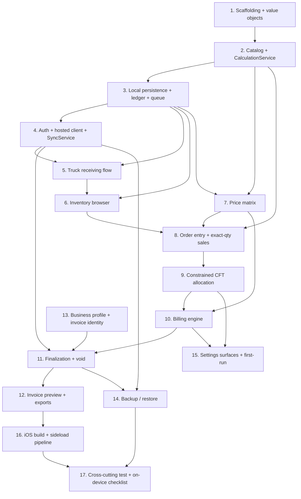

# Implementation Plan: Wood CFT

## Overview

This plan converts the Wood CFT design into incremental, buildable coding steps for a single-user Flutter/Cupertino iPhone app. The implementation language is **Dart/Flutter** (as fixed by `design.md`; no pseudocode).

Work proceeds in the product-brief priority order: pure-Dart domain foundations first (fully testable on Windows), then the shared CFT/money engine, then local persistence and sync, then receiving, browsing, pricing, order entry, allocation, billing, finalization/void, exports, settings, backup, and finally the macOS CI build + sideload pipeline. A cross-cutting test suite closes out the plan.

Every task builds on earlier tasks and is wired into the app so there is no orphaned code. Property-based tests implement the design's Correctness Properties 1–31 (one test per property, ≥100 iterations, tagged). Requirement 21 worked examples are pinned as unit tests close to the code they verify.

> **To-be-verified at implementation time:** the Flutter/Dart SDK patch and pairing, `drift` vs `sqflite`, the Supabase Dart client, the exact-rational package (`package:rational`) and decimal/`Money` approach, DOCX/share packages, the PBT library, and the macOS CI runner image. These are starting points from the design, not confirmed dependencies.

> **Device-only verifications** (iOS build install, Sideloadly, DOCX attachment sharing in WhatsApp, VoiceOver/accessibility) MUST be executed on a physical iPhone and MUST NOT be reported as passed unless actually performed off no automated substitute.

## Task Dependency Graph



```json
{
  "waves": [
    { "id": 0, "tasks": ["1.1"] },
    { "id": 1, "tasks": ["1.2", "1.3", "1.4"] },
    { "id": 2, "tasks": ["1.5", "1.6", "2.1"] },
    { "id": 3, "tasks": ["2.2", "2.3", "2.6"] },
    { "id": 4, "tasks": ["2.4", "2.5", "3.1"] },
    { "id": 5, "tasks": ["3.2", "3.3", "4.1", "13.1"] },
    { "id": 6, "tasks": ["3.4", "4.2", "7.1", "13.2"] },
    { "id": 7, "tasks": ["4.3", "7.2", "5.1"] },
    { "id": 8, "tasks": ["4.4", "4.5", "5.2", "5.3", "5.4", "6.1"] },
    { "id": 9, "tasks": ["5.5", "6.2", "8.1"] },
    { "id": 10, "tasks": ["6.3", "8.2", "9.1"] },
    { "id": 11, "tasks": ["9.2", "9.3", "9.4"] },
    { "id": 12, "tasks": ["9.5", "9.6", "9.7", "9.8", "9.9", "10.1"] },
    { "id": 13, "tasks": ["10.2"] },
    { "id": 14, "tasks": ["10.3"] },
    { "id": 15, "tasks": ["10.4", "10.5", "11.1"] },
    { "id": 16, "tasks": ["11.2", "11.3", "11.4"] },
    { "id": 17, "tasks": ["11.5", "11.6", "11.7", "12.1", "12.2"] },
    { "id": 18, "tasks": ["12.3", "14.1"] },
    { "id": 19, "tasks": ["12.4", "14.2", "15.1"] },
    { "id": 20, "tasks": ["15.2", "16.1"] },
    { "id": 21, "tasks": ["16.2", "17.1", "17.2", "17.4"] },
    { "id": 22, "tasks": ["17.3", "17.5"] }
  ]
}
```

## Tasks

- [x] 1. Project scaffolding and domain value objects
  - Initialize the Flutter project, pin a stable SDK, lay down the layered folder structure (presentation / application / domain / data), a Cupertino theme skeleton (restrained neutral theme, single accent, light/dark, no wood photography), and Riverpod wiring. Add the pure-Dart exact-rational `Cft` and `Money` (paise) value objects that every later layer depends on.
  - _Design:_ Overview → Stack decision; Architecture; CFT and Currency Arithmetic
  - _Requirements:_ 2.1, 2.2, 9.1, 17.1, 17.7

  - [x] 1.1 Initialize Flutter project, SDK pin, and layered structure
    - Create the Flutter app, pin the stable SDK (to-be-verified patch + Dart pairing), add `analysis_options.yaml`, and create the domain/application/data/presentation folders with the domain layer free of any Flutter/IO imports so it runs under `flutter test` on Windows.
    - _Design:_ Architecture (strict inward dependency, pure-Dart domain)
    - _Requirements:_ 20.1
    - _Verification:_ `flutter analyze` passes; a trivial pure-Dart domain test runs green via `flutter test` on Windows.

  - [x] 1.2 Add Cupertino theme skeleton and Riverpod wiring
    - Build the root `CupertinoApp`/theme with light + dark neutral theme and single accent, and wire the Riverpod `ProviderScope`. No business logic.
    - _Design:_ Architecture (Presentation, Application/Services); Screen Flows
    - _Requirements:_ 17.1, 17.7
    - _Depends on:_ 1.1
    - _Verification:_ Widget test boots the app under light and dark `CupertinoThemeData` without error.

  - [x] 1.3 Implement the exact-rational `Cft` value object
    - Wrap an exact rational (big-integer numerator/denominator, candidate `package:rational`, to-be-verified) for CFT; expose exact multiply/add and a display-only `toFixed(4)` formatter that never mutates the stored value.
    - _Design:_ CFT and Currency Arithmetic (Exact rational volume)
    - _Requirements:_ 2.1, 2.2, 2.6, 2.7
    - _Depends on:_ 1.1
    - _Verification:_ Unit tests pin Req 21.1 (`1/12 → 0.0833`), 21.2 (`5/6 → 0.8333`), 21.3 (`25/18 → 1.3889`), 21.4 (`2.0000` exact); confirms display rounding leaves the exact value unchanged (Property 4).

  - [x] 1.4 Implement the `Money`/paise value object with half-up rounding and INR formatting
    - Integer-paise (or `package:decimal`, to-be-verified) money type with exact multiply by a rational rate, round-half-up to paise, and INR formatting at 2 dp with Indian digit grouping. No binary float.
    - _Design:_ CFT and Currency Arithmetic (Currency)
    - _Requirements:_ 9.1, 9.2, 9.5
    - _Depends on:_ 1.1
    - _Verification:_ Unit tests cover half-up boundaries and Indian grouping; feeds Properties 14 later.

  - [x]* 1.5 Write property test for the exact CFT formula and unit scaling
    - **Property 1: Exact CFT formula** and **Property 2: Unit scaling (bunch and line) is exact multiplication**
    - **Validates: Requirements 2.1, 2.2, 2.3, 2.4**
    - Tag: `Feature: wood-cft-app, Property 1` and `Property 2`; ≥100 iterations each.
    - _Depends on:_ 1.3

  - [x]* 1.6 Write property test for display rounding and money line amount
    - **Property 4: Display rounding never alters computation** and **Property 14 (line-amount portion): line amount is exact before half-up rounding**
    - **Validates: Requirements 2.6, 2.7, 9.1, 9.2**
    - Tag format `Feature: wood-cft-app, Property {N}: {text}`; ≥100 iterations.
    - _Depends on:_ 1.3, 1.4

- [x] 2. Catalog domain models and the shared CalculationService
  - Define the catalog domain entities and seed data, then build the single shared CFT engine used by receiving, stock views, allocation, billing, and exports so previews and invoices can never disagree.
  - _Design:_ Components and Interfaces (shared CalculationService); Data Models; CFT and Currency Arithmetic
  - _Requirements:_ 1.*, 2.*, 3.*

  - [x] 2.1 Implement WoodVariety, CrossSection, StockItem domain models
    - Pure-Dart entities: `WoodVariety` (name, active), `CrossSection` (width_in, thickness_in, category Reaper|Plank, bunch_size 10|1, active), `StockItem` keyed by variety+cross-section+length_ft (2–9), with inch-label formatting `"W × T in"` and units kept distinct (inches vs feet).
    - _Design:_ Data Models (entity table)
    - _Requirements:_ 1.8, 1.9, 1.10, 1.11, 3.1, 3.3
    - _Depends on:_ 1.3
    - _Verification:_ Unit tests assert label format and that thickness is the second dimension used in the volume formula.

  - [x] 2.2 Implement the catalog seed and zero-stock/no-price initialization
    - Seed varieties Mahogany, Kalani, Palajathi (exact spelling) and cross-sections 2×1 Reaper plus 3×1,4×1,5×1,6×1,7×1 Plank; set every stock quantity to zero; seed no prices and no fictional stock.
    - _Design:_ Screen Flows → First-run setup; Data Models
    - _Requirements:_ 1.1, 1.2, 1.12
    - _Depends on:_ 2.1
    - _Verification:_ Unit test asserts seeded names/sizes/categories, all balances zero, zero price rows.

  - [x] 2.3 Implement the shared CalculationService (CFT engine)
    - Single implementation of `CFT_per_piece = W×T×L/144` (never 1728), bunch CFT = per-piece×10, line CFT = per-piece×qty, total CFT = exact unrounded sum; expose piece-equivalent for reaper bunches.
    - _Design:_ Components and Interfaces; CFT and Currency Arithmetic
    - _Requirements:_ 2.1, 2.2, 2.3, 2.4, 2.5, 3.4
    - _Depends on:_ 1.3, 2.1
    - _Verification:_ Unit tests pin Req 21.5 (3 bunches Mahogany 2×1 @6 ft → 30 pcs, 2.5 CFT) and totals summation.

  - [x]* 2.4 Write property test for total-CFT exact order-independent sum
    - **Property 3: Total CFT is the exact order-independent sum of line CFT**
    - **Validates: Requirements 2.5, 9.6**
    - Tag `Feature: wood-cft-app, Property 3`; ≥100 iterations.
    - _Depends on:_ 2.3

  - [x]* 2.5 Write property test for whole-unit invariant and piece-equivalence
    - **Property 5: Whole-unit invariant for sale quantities**
    - **Validates: Requirements 3.1, 3.2, 3.3, 3.4, 8.8**
    - Tag `Feature: wood-cft-app, Property 5`; ≥100 iterations.
    - _Depends on:_ 2.1, 2.3

  - [x] 2.6 Implement catalog mutation (add/rename/deactivate) rules
    - Add a new variety, rename, deactivate (unavailable for new receiving/selling), never auto-merge, and preserve historical invoice variety names as issued (snapshot semantics defined here, enforced at finalize).
    - _Design:_ Data Models (deactivate never delete); Screen Flows → Settings
    - _Requirements:_ 1.3, 1.4, 1.5, 1.6, 1.7
    - _Depends on:_ 2.1
    - _Verification:_ Unit tests cover rename/deactivate behavior and no-merge; invoice-name retention is re-verified in task 11.

- [x] 3. Local persistence, movement ledger, and pending-op queue
  - Build the on-device SQLite cache (candidate `drift`, to-be-verified) mirroring the hosted schema, the append-only movement ledger with a transactionally-maintained balance and reconciliation invariant, idempotency keys and `sync_state`, and the durable pending-operation queue.
  - _Design:_ Data Models (local vs hosted schema); Transaction Boundaries & Sync
  - _Requirements:_ 5.6, 5.13, 19.2, 19.7

  - [x] 3.1 Define the local cache schema and migrations
    - Tables mirroring the design (WoodVariety, CrossSection, StockItem with confirmed/pending balances, StockMovement, ReceiptSession/Entry, PriceRate, Draft/AllocationLine, Invoice/InvoiceLine, settings singletons, PendingOperation, BackupMeta); unique(variety,cross-section,length), non-null invoice-line FK, unique idempotency keys.
    - _Design:_ Data Models (table + ER diagram)
    - _Requirements:_ 19.2
    - _Depends on:_ 2.1
    - _Verification:_ Schema migration test boots an empty DB and asserts constraints (unique stock key, non-null FK) reject violations.

  - [x] 3.2 Implement the movement ledger with transactional balance and reconciliation invariant
    - Insert signed `StockMovement` rows (type, delta_pieces, occurred_at, idempotency_key, sync_state) and maintain `confirmed_balance_pieces`/`pending_balance_pieces` inside one local transaction; expose a reconciliation check (balance == signed sum of movements).
    - _Design:_ Data Models (reconciliation invariant); Transaction Boundaries & Sync (local-only)
    - _Requirements:_ 5.13, 6.2
    - _Depends on:_ 3.1
    - _Verification:_ Unit tests assert balance equals signed-sum after a mix of movements (Property 22 target).

  - [x] 3.3 Implement the durable pending-operation queue
    - Enqueue `PendingOperation` rows (op_type, payload, idempotency_key unique, enqueued_at, attempts, sync_state, last_error) within the same transaction as the local write; expose ordered reads and state transitions.
    - _Design:_ Data Models (PendingOperation); Transaction Boundaries & Sync (Sync engine)
    - _Requirements:_ 5.6, 19.7
    - _Depends on:_ 3.1
    - _Verification:_ Unit test confirms enqueue is atomic with the movement write and that a duplicate idempotency key is rejected/no-op.

  - [x]* 3.4 Write property test for ledger/balance reconciliation
    - **Property 22: Balance reconciles with the movement ledger**
    - **Validates: Requirements 5.13, 6.2**
    - Tag `Feature: wood-cft-app, Property 22`; ≥100 iterations over random movement sequences.
    - _Depends on:_ 3.2

- [x] 4. Authentication, hosted DB client, and SyncService
  - Add the authenticated owner session and hosted client (Supabase preferred with anon key + RLS; Neon only via an authenticated API; no service-role keys embedded), then the SyncService that drains the queue in order, applies idempotently with retry/backoff, promotes pending→confirmed, and surfaces failed ops.
  - _Design:_ Architecture (Hosted-DB access and credentials); Transaction Boundaries & Sync (Sync engine)
  - _Requirements:_ 19.3, 19.4, 19.5, 19.6, 19.9, 19.10

  - [x] 4.1 Implement AuthService (authenticated owner session)
    - Sign-in/session management required for privileged hosted access; expose session state to gate finalize/sync; keep Apple/DB credentials out of the app bundle.
    - _Design:_ Architecture (credentials); Components and Interfaces (AuthService)
    - _Requirements:_ 19.3, 19.6
    - _Depends on:_ 3.1
    - _Verification:_ Unit test asserts privileged calls are refused without a session; integration test deferred to task 17.

  - [x] 4.2 Implement the hosted DB client (Supabase preferred / Neon alternative)
    - Supabase Dart client with client-safe anon key + RLS keyed to the owner session; Neon path reached only through an authenticated API. No direct Postgres credentials or service-role keys in the app.
    - _Design:_ Architecture (Hosted-DB access and credentials)
    - _Requirements:_ 19.1, 19.4, 19.5, 19.6
    - _Depends on:_ 4.1
    - _Verification:_ Static/smoke check that no privileged key appears in source/bundle (full check in task 17); client config review.

  - [x] 4.3 Implement SyncService (ordered drain, idempotent apply, retry/backoff)
    - Drain the pending-op queue in enqueue order; apply each op with its idempotency key so retries/duplicates apply exactly once; exponential backoff on uncertain outcomes; on confirmation flip sync_state and move pending→confirmed balance; mark server-rejected ops `Failed` with `last_error` and never promote them.
    - _Design:_ Transaction Boundaries & Sync (Sync engine); Error Handling
    - _Requirements:_ 19.8, 19.9, 19.10
    - _Depends on:_ 3.3, 4.2
    - _Verification:_ Unit tests against an in-memory hosted double simulate lost responses → exactly-once; failed-op surfacing.

  - [x]* 4.4 Write property test for idempotent operation application
    - **Property 19: Operation application is idempotent under a repeated idempotency key**
    - **Validates: Requirements 5.9, 12.3, 13.3, 19.9, 19.10, 21.7, 21.26**
    - Runs against the in-memory/mocked store. Tag `Feature: wood-cft-app, Property 19`; ≥100 iterations.
    - _Depends on:_ 4.3

  - [x]* 4.5 Write property test for pending-vs-confirmed sellability
    - **Property 21: Only confirmed stock is sellable**
    - **Validates: Requirements 5.6, 19.8, 21.27**
    - Tag `Feature: wood-cft-app, Property 21`; ≥100 iterations over mixed pending/confirmed movement sets.
    - _Depends on:_ 3.2, 4.3

- [x] 5. Truck receiving flow
  - Build ReceiptSession/ReceiptEntry with the compact 2–9 ft length grid, bunch-vs-piece input, immediate local commit + enqueue (pending, not sellable), resume-after-restart, opening stock, and adjustment/reversal with a negative-stock guard and undo.
  - _Design:_ Screen Flows → Stock tab (receiving session); Transaction Boundaries & Sync (local-only a/b); Error Handling
  - _Requirements:_ 5.*

  - [x] 5.1 Implement ReceivingService session lifecycle and immediate local commit
    - Create/resume an active receipt; within one local transaction insert ReceiptEntry + Receive/Opening StockMovement (sync_state Pending), increment pending balance, enqueue the pending op with a stable idempotency key; show quantity as Pending_Receiving_Stock, not sellable until synced.
    - _Design:_ Transaction Boundaries & Sync (local-only a)
    - _Requirements:_ 5.1, 5.6, 5.6a, 5.8, 5.9, 19.7, 19.8
    - _Depends on:_ 3.3, 2.3
    - _Verification:_ Unit tests pin Req 21.6 (resume + finish does not double-add) and 21.27 (pending not sellable); repeated key is a no-op.

  - [x] 5.2 Build the compact length grid UI with bunch/piece input
    - Cupertino receiving screen: select variety + cross-section (selection stays active across the grid), enter quantities per length 2–9 ft; reapers accept bunches and show piece-equivalent, planks accept pieces. Receive-stock action is prominent on the Stock tab.
    - _Design:_ Screen Flows → Stock tab; Receiving session diagram
    - _Requirements:_ 5.2, 5.3, 5.4, 5.5, 17.9
    - _Depends on:_ 5.1
    - _Verification:_ Widget test confirms selection persistence across the grid and piece-equivalent display for reapers.

  - [x] 5.3 Implement resume-after-restart recovery
    - On reopen with an active receipt, recover the session so an interrupted entry is not lost or double-applied.
    - _Design:_ Screen Flows → Stock tab; Transaction Boundaries & Sync
    - _Requirements:_ 5.7, 20.6
    - _Depends on:_ 5.1
    - _Verification:_ Unit/widget test simulates restart (reload from store) and asserts the active receipt and entries are restored once.

  - [x] 5.4 Implement opening stock, adjustment/reversal with negative-stock guard and undo
    - Opening-stock entry; adjustments/reversals each record a required reason; a transaction that would drive availability negative aborts wholesale and surfaces a blocking error; edits/undo go through validated adjustment/reversal entries.
    - _Design:_ Transaction Boundaries & Sync (local-only b); Error Handling (negative-availability guard)
    - _Requirements:_ 5.10, 5.11, 5.12, 5.13
    - _Depends on:_ 5.1, 3.2
    - _Verification:_ Unit test pins Req 21.19 (undo to negative blocked, balance unchanged) → Property 20 target.

  - [x]* 5.5 Write property test for negative-availability rejection
    - **Property 20: Negative-availability adjustments are rejected without side effects**
    - **Validates: Requirements 5.12, 21.19**
    - Tag `Feature: wood-cft-app, Property 20`; ≥100 iterations.
    - _Depends on:_ 5.4

- [x] 6. Inventory browser
  - Build the Stock-tab browser with filters, per-item available quantity and CFT, filtered totals, zero-stock show/hide, pending/confirmed badges, and explicit unit labels; shortage never conveyed by color alone.
  - _Design:_ Screen Flows → Stock tab (inventory browser)
  - _Requirements:_ 6.*, 17.5, 17.6

  - [x] 6.1 Implement inventory query + filter logic
    - Filter by variety, category, cross-section, length; compute per-item available quantity and available CFT (via CalculationService) and totals across the current filter from confirmed balances.
    - _Design:_ Screen Flows → Stock tab
    - _Requirements:_ 6.1, 6.2, 6.3
    - _Depends on:_ 3.2, 2.3
    - _Verification:_ Unit test asserts filtered totals equal the exact sum over passing items (Property 23 target).

  - [x] 6.2 Build the browser UI (badges, zero-stock toggle, unit labels)
    - Render items with pending vs confirmed badges, a show/hide zero-stock toggle, quantity + CFT with explicit unit labels, and a non-color shortage indicator.
    - _Design:_ Screen Flows → Stock tab; First-run/accessibility
    - _Requirements:_ 6.4, 6.5, 17.5, 17.6, 19.8
    - _Depends on:_ 6.1
    - _Verification:_ Widget test asserts zero-stock toggle, unit labels, and a non-color shortage cue are present.

  - [x]* 6.3 Write property test for inventory totals over the active filter
    - **Property 23: Inventory totals equal the sum over the active filter**
    - **Validates: Requirements 6.1, 6.3**
    - Tag `Feature: wood-cft-app, Property 23`; ≥100 iterations.
    - _Depends on:_ 6.1

- [x] 7. Price matrix
  - Build PriceRate storage per variety×cross-section (length-independent), an editable grid with visible missing-rate markers, receiving allowed before prices, and a missing-rate flag during selling.
  - _Design:_ Screen Flows → Settings (price matrix); Data Models (PriceRate)
  - _Requirements:_ 4.1, 4.2, 4.3, 4.4, 4.5, 4.6, 17.13, 17.14

  - [x] 7.1 Implement PricingService (rate storage + missing-rate detection)
    - Store rate as exact rational ₹/CFT GST-exclusive, keyed by variety×cross-section only (never by length); nullable = missing; create empty rate entries when a variety is added (never inferred); detect/report every missing rate.
    - _Design:_ Components and Interfaces (PricingService); Data Models
    - _Requirements:_ 4.1, 4.2, 4.4, 4.5
    - _Depends on:_ 3.1, 2.6
    - _Verification:_ Unit test asserts rate independence from length and empty-rate creation on new variety.

  - [x] 7.2 Build the editable price-matrix grid with missing markers
    - Variety × cross-section editable table with visible markers on every missing rate; allow receiving stock with a missing rate; selling flags a missing rate.
    - _Design:_ Screen Flows → Settings; First-run (receiving before prices)
    - _Requirements:_ 4.3, 4.6, 17.13, 17.14
    - _Depends on:_ 7.1
    - _Verification:_ Widget test shows missing-rate markers and confirms receiving is not blocked by a missing rate.

- [x] 8. Order entry and exact-quantity sales
  - Build the four structured request types (no NL/AI) and implement exact-quantity allocation first (validate stock, no silent reduction) as the simplest sell path, wired into the Sell tab.
  - _Design:_ Screen Flows → Sell tab (order request entry); Allocation Behavior (hard constraints)
  - _Requirements:_ 7.1, 7.2, 7.3, 7.4, 7.5, 8.1, 8.3

  - [x] 8.1 Implement order-request domain + exact-quantity allocation
    - Structured `DraftOrderRequest` for the four types; implement exact-quantity allocation that validates confirmed availability and never silently reduces a requested quantity.
    - _Design:_ Data Models (DraftOrderRequest); Allocation Behavior
    - _Requirements:_ 7.1, 7.2, 8.1, 8.3
    - _Depends on:_ 6.1, 7.1
    - _Verification:_ Unit test: exact-qty request within stock allocates exactly; over-stock yields a labeled partial (not silently reduced).

  - [x] 8.2 Build the Sell-tab order entry UI (4 request types)
    - Cupertino entry for exact quantity, target CFT + exact length, target CFT + exact cross-section (flexible lengths), target CFT + category (flexible lengths); structured only.
    - _Design:_ Screen Flows → Sell tab
    - _Requirements:_ 7.1, 7.3, 7.4, 7.5
    - _Depends on:_ 8.1
    - _Verification:_ Widget test exercises all four request-type forms producing a valid draft request.

- [x] 9. Constrained CFT allocation (AllocationService)
  - Implement the deterministic bounded heuristic: single-SKU meet-or-exceed ceil, flexible reaper 60/30/10 CFT shares with 8–9 ft exclusion and deficit redistribution, flexible plank whole-piece min-excess (no reaper weights), the stable tie-breaker, multi-line remaining-availability, and labeled partial/understock — explicitly not claimed optimal.
  - _Design:_ Allocation Behavior
  - _Requirements:_ 7.6, 8.*

  - [x] 9.1 Implement single-SKU meet-or-exceed and hard-constraint enforcement
    - `required_units = ceil(target_CFT / CFT_per_sale_unit)` (exact), bill actual allocated CFT; enforce length, cross-section/category, whole-unit, and availability as hard constraints; fixed-length that cannot be met never silently mixes other lengths.
    - _Design:_ Allocation Behavior (hard constraints, target handling)
    - _Requirements:_ 7.6, 8.1, 8.2, 8.3, 8.5
    - _Depends on:_ 8.1, 2.3
    - _Verification:_ Unit tests pin Req 21.9 (5 CFT 2×1 @6 ft → 6 bunches), 21.10 (@7 ft 4.8611/5.8333 → 6), 21.12 (no silent mixing).

  - [x] 9.2 Implement flexible reaper length-share heuristic with redistribution
    - Apply 60/30/10 shares to allocated CFT across {6,7}/{3,4,5}/{2}; exclude 8–9 ft unless fallback enabled; redistribute preferred-group deficit among eligible groups; keep every reaper quantity a multiple of 10 pieces; approximate stock-aware, not an integer-bunch guarantee.
    - _Design:_ Allocation Behavior (flexible reaper heuristic)
    - _Requirements:_ 8.7, 8.8, 8.9, 8.10
    - _Depends on:_ 9.1
    - _Verification:_ Unit test pins Req 21.11 group tests (abundance, preferred-share shortage, no-2 ft, total shortage) — whole bunches, 8–9 ft excluded, repeatable.

  - [x] 9.3 Implement flexible plank whole-piece min-excess allocation
    - Whole pieces, round up to meet-or-exceed with smallest excess CFT, apply the stable tie-breaker (lower length, then lower stock-item id); never apply reaper length-group shares to planks.
    - _Design:_ Allocation Behavior (flexible plank)
    - _Requirements:_ 8.10, 8.11
    - _Depends on:_ 9.1
    - _Verification:_ Unit test pins Req 21.13 (flexible plank uses no reaper shares).

  - [x] 9.4 Implement multi-line remaining-availability and partial labeling
    - Allocate each line against remaining availability so no quantity is counted twice; produce a clearly labeled partial proposal with the shortage when stock is insufficient; mark the heuristic as not optimal.
    - _Design:_ Allocation Behavior (multi-line and understock, stated limitations)
    - _Requirements:_ 8.4, 8.6, 8.12
    - _Depends on:_ 9.1
    - _Verification:_ Unit test pins Req 21.14 (no reuse across lines) and partial-labeling honesty.

  - [x] 9.5 Build allocation review / picking-list UI
    - Show requested vs allocated vs over/under CFT, editable picking list; partial clearly labeled with shortage, never "fulfilled".
    - _Design:_ Screen Flows → Sell tab (allocation review)
    - _Requirements:_ 8.3, 8.4
    - _Depends on:_ 9.1, 9.2, 9.3, 9.4, 8.2
    - _Verification:_ Widget test shows requested/allocated/±CFT and a labeled partial.

  - [x]* 9.6 Write property test for meet-or-exceed single-SKU unit count
    - **Property 6: Meet-or-exceed single-SKU unit count**
    - **Validates: Requirements 7.6, 8.2**
    - Tag `Feature: wood-cft-app, Property 6`; ≥100 iterations.
    - _Depends on:_ 9.1

  - [x]* 9.7 Write property test for hard constraints and allocation honesty
    - **Property 7: Hard constraints are never violated** and **Property 8: Allocation honesty (no silent reduction; partial labeled with shortage)**
    - **Validates: Requirements 8.1, 8.3, 8.4**
    - Tags `Feature: wood-cft-app, Property 7` / `Property 8`; ≥100 iterations each.
    - _Depends on:_ 9.1, 9.4

  - [x]* 9.8 Write property test for billing-uses-allocated-CFT and multi-line no-double-count
    - **Property 9: Billing uses actual allocated CFT** and **Property 10: Multi-line allocation never double-counts stock**
    - **Validates: Requirements 8.5, 8.6, 21.14**
    - Tags `Property 9` / `Property 10`; ≥100 iterations each.
    - _Depends on:_ 9.1, 9.4

  - [x]* 9.9 Write property test for determinism/tie-breaker and flexible exclusions
    - **Property 11: Allocation is deterministic with a stable tie-breaker**, **Property 12: Flexible reaper excludes 8–9 ft and never applies reaper weights to planks**, **Property 13: Flexible plank uses whole pieces with minimal meet-or-exceed excess**
    - **Validates: Requirements 8.7, 8.9, 8.10, 8.11, 8.12, 21.11, 21.13**
    - Tags `Property 11` / `Property 12` / `Property 13`; ≥100 iterations each.
    - _Depends on:_ 9.2, 9.3, 9.4

- [x] 10. Billing engine
  - Compute goods subtotal (sum of rounded lines), single-line literal GST (No/9%/18%), loading tiers on exact CFT (<20 → ₹100, ≥20 → ₹150, after tax, untaxed), payable, and INR Indian-grouped display.
  - _Design:_ CFT and Currency Arithmetic (Currency); Allocation Behavior
  - _Requirements:_ 9.*, 10.*, 11.*

  - [x] 10.1 Implement goods subtotal and line amounts
    - Line amount = exact allocated CFT × rate (exact), round each half-up to paise, goods subtotal = sum of rounded line amounts; compute total volumes by summing unrounded exact CFT.
    - _Design:_ CFT and Currency Arithmetic (Currency)
    - _Requirements:_ 9.1, 9.2, 9.3, 9.6
    - _Depends on:_ 1.4, 9.1, 7.1
    - _Verification:_ Unit test pins Req 21.8 goods ₹1,666.67.

  - [x] 10.2 Implement literal single-line GST
    - Tax modes No GST, 9%, 18% as a single tax line (never CGST/SGST split); tax = taxable_subtotal × literal rate; zero for No GST; taxable_subtotal = goods subtotal (loading excluded).
    - _Design:_ CFT and Currency Arithmetic; Correctness Property 15
    - _Requirements:_ 10.1, 10.2, 10.3, 10.4, 10.5
    - _Depends on:_ 10.1
    - _Verification:_ Unit test pins Req 21.17 (tax modes) and 21.18 (tax ₹180).

  - [x] 10.3 Implement loading charge and payable
    - Loading from exact total sold CFT (<20 → ₹100, ≥20 incl. exactly 20 → ₹150), once per order, added after tax, excluded from taxable base, applied even in No-GST, never on receiving/empty/cancelled; payable = goods + tax + loading; INR 2 dp Indian grouping; no whole-rupee rounding.
    - _Design:_ CFT and Currency Arithmetic (Currency); Correctness Properties 16, 17
    - _Requirements:_ 9.5, 11.1, 11.2, 11.3, 11.4, 11.5, 11.6, 11.7
    - _Depends on:_ 10.2
    - _Verification:_ Unit test pins Req 21.8 payable ₹1,766.67, 21.16 loading tiers (incl. exactly 20), 21.18 payable ₹1,280.

  - [x]* 10.4 Write property test for line amount + goods subtotal and single-line tax
    - **Property 14: Line amount is exact before half-up rounding, and goods subtotal sums rounded lines** and **Property 15: Single-line literal tax on the taxable subtotal**
    - **Validates: Requirements 9.1, 9.2, 9.3, 10.1, 10.2, 10.3, 10.5**
    - Tags `Property 14` / `Property 15`; ≥100 iterations each.
    - _Depends on:_ 10.1, 10.2

  - [x]* 10.5 Write property test for loading exclusion/placement and tier step function
    - **Property 16: Loading is excluded from tax, added once after tax** and **Property 17: Loading tier is a step function on exact CFT at 20**
    - **Validates: Requirements 9.4, 10.4, 11.1, 11.2, 11.3, 11.4, 11.5, 11.6**
    - Tags `Property 16` / `Property 17`; ≥100 iterations each (include exact-CFT boundary near 20).
    - _Depends on:_ 10.3

- [x] 11. Transactional finalization and void
  - Implement the auth+connectivity-gated single hosted transaction (revalidate confirmed stock + rates, write immutable invoice snapshots, assign permanent number inside the txn, deduct stock), idempotent exactly-once retry, offline→stay-draft, draft/preview/share never mutate stock, void restoring once with the original retained, and snapshot immutability.
  - _Design:_ Transaction Boundaries & Sync (hosted-transactional d/e); Error Handling
  - _Requirements:_ 4.7, 4.8, 4.9, 12.*, 13.*, 15.6

  - [x] 11.1 Implement finalize as a single authenticated hosted transaction
    - Require an authenticated session + connectivity; in one hosted transaction revalidate Confirmed_Available_Stock and that every sold line has a valid rate, write Invoice + immutable InvoiceLine snapshots (variety name/label/rate snapshotted), assign the permanent invoice number inside the transaction, deduct stock via confirmed Sale movements; block finalize on missing rate/stock; offline/no-session keeps the order a draft.
    - _Design:_ Transaction Boundaries & Sync (d)
    - _Requirements:_ 4.7, 12.1, 12.2, 12.4, 12.5, 12.6, 1.6
    - _Depends on:_ 10.3, 4.1, 4.3, 2.6
    - _Verification:_ Unit tests pin Req 21.15 (missing stock/rate blocks), 21.20 (atomic — injected failure leaves pre-state), 21.21 (draft/preview no stock change); integration atomicity in task 17.

  - [x] 11.2 Implement idempotent exactly-once finalize retry
    - Protect finalize with an idempotency key so repeated finalize (including lost/timed-out responses retried with the same key) yields exactly one invoice and one deduction.
    - _Design:_ Transaction Boundaries & Sync (d); Error Handling
    - _Requirements:_ 12.3, 12.3a, 12.3b
    - _Depends on:_ 11.1
    - _Verification:_ Unit test pins Req 21.7 and 21.26 (no duplicate invoice/deduction on retry) — Property 19.

  - [x] 11.3 Implement void/reversal
    - In one hosted transaction mark the invoice Voided (original retained, never deleted), insert Void movements restoring exactly the deducted pieces, update balances, record the void idempotency key; retried voids restore stock exactly once.
    - _Design:_ Transaction Boundaries & Sync (e)
    - _Requirements:_ 13.1, 13.2, 13.3
    - _Depends on:_ 11.1
    - _Verification:_ Unit test pins Req 21.23 (void restores once).

  - [x] 11.4 Enforce invoice-snapshot immutability and no-mutation on share
    - Finalized snapshots are immutable to later catalog/rate/tax/loading changes; sharing/exporting never re-deducts stock.
    - _Design:_ Transaction Boundaries & Sync; Correctness Properties 18, 24
    - _Requirements:_ 4.8, 4.9, 12.7, 15.6
    - _Depends on:_ 11.1
    - _Verification:_ Unit test pins Req 21.22 (rate/catalog change does not alter issued invoice).

  - [x] 11.5 Build the invoice-preview + finalize UI gating
    - Invoice preview from the shared calculation; flag a missing rate and block finalize; finalize button requires auth + connectivity else keep draft with a clear reason.
    - _Design:_ Screen Flows → Sell tab (invoice preview, finalize)
    - _Requirements:_ 4.7, 12.2, 12.3b, 17.14
    - _Depends on:_ 11.1, 9.5
    - _Verification:_ Widget test: missing rate blocks finalize; offline keeps draft with reason shown.

  - [x]* 11.6 Write property test for non-finalizing actions never mutating stock
    - **Property 18: Non-finalizing actions never mutate stock**
    - **Validates: Requirements 12.1, 12.5, 15.6, 21.21**
    - Tag `Feature: wood-cft-app, Property 18`; ≥100 iterations.
    - _Depends on:_ 11.1

  - [x]* 11.7 Write property test for snapshot immutability, void restoration, and missing-rate block
    - **Property 24: Finalized invoice snapshots are immutable to later changes**, **Property 25: Void restores exactly the deducted stock and retains the original**, **Property 26: Missing rate blocks finalization**
    - **Validates: Requirements 4.7, 4.8, 4.9, 12.7, 13.1, 13.2, 21.15, 21.22, 21.23**
    - Tags `Property 24` / `Property 25` / `Property 26`; ≥100 iterations each (idempotency store in-memory).
    - _Depends on:_ 11.3, 11.4

- [x] 12. Invoice preview exports (DOCX + WhatsApp text)
  - Implement ExportService producing a genuine OOXML .docx (valid package, business header, invoice-and-customer block, item table, totals, repeated multi-page header, readable filename) and WhatsApp text (headings/line breaks/emphasis, no Markdown tables, matching the snapshot), with Share file / Share text / Copy text via the iOS share sheet and a generic fallback.
  - _Design:_ Export Strategy
  - _Requirements:_ 14.*, 15.*

  - [x] 12.1 Implement DOCX generation from the invoice snapshot
    - Produce a valid OOXML .docx (zip with at least `[Content_Types].xml` and `word/document.xml`) from the same persisted Invoice_Snapshot as the preview; business header, invoice-and-customer block, item table, totals; repeat header on each page of a multi-page invoice; human-readable filename. Never a renamed text/HTML; PDF does not satisfy this.
    - _Design:_ Export Strategy (Word document)
    - _Requirements:_ 14.1, 14.2, 14.3, 14.4, 14.5, 14.6
    - _Depends on:_ 11.1
    - _Verification:_ Unit test (Req 21.24, automatable part) unzips the output and asserts required OOXML parts; attachment sharing is device-only (task 17).

  - [x] 12.2 Implement WhatsApp text generation
    - Formatted text from the same snapshot: simple headings, line breaks, WhatsApp emphasis (`*bold*`), no Markdown tables; values match preview and DOCX exactly.
    - _Design:_ Export Strategy (WhatsApp text)
    - _Requirements:_ 15.1, 15.2, 15.3
    - _Depends on:_ 11.1
    - _Verification:_ Unit test asserts no Markdown-table syntax and value equality with the snapshot.

  - [x] 12.3 Wire share/copy actions and PDF-as-optional
    - Share invoice file, Share bill text, Copy bill text via the iOS share sheet with a generic fallback when WhatsApp is absent; sharing never re-deducts stock; any PDF is optional-extra only and never replaces DOCX/WhatsApp.
    - _Design:_ Export Strategy (actions, PDF)
    - _Requirements:_ 15.4, 15.5, 15.6, 15.7
    - _Depends on:_ 12.1, 12.2
    - _Verification:_ Widget test shows all three actions; on-device share verified in task 17.

  - [x]* 12.4 Write property test for export consistency and valid OOXML package
    - **Property 27: Export outputs are consistent with the snapshot** and **Property 28: Exported DOCX is a valid OOXML package**
    - **Validates: Requirements 14.1, 14.2, 14.3, 15.1, 15.2, 15.3**
    - Tags `Property 27` / `Property 28`; ≥100 iterations over generated snapshots.
    - _Depends on:_ 12.1, 12.2

- [x] 13. Business profile and invoice identity
  - Configure the shop identity (name/address/phone/optional logo/optional GSTIN/invoice prefix), optional customer name/phone, and tax-invoice fields; never assume a default business name or fabricate registration; incomplete statutory fields → simple sales bill, not a verified compliant tax invoice.
  - _Design:_ Screen Flows → Settings (business profile); Correctness Property 31
  - _Requirements:_ 18.*
  - _Depends on:_ 3.1

  - [x] 13.1 Implement BusinessSettings model + settings UI
    - Editable business profile and optional customer fields; tax-invoice statutory fields; invoice prefix feeds finalize numbering.
    - _Design:_ Data Models (BusinessSettings); Screen Flows → Settings
    - _Requirements:_ 18.1, 18.2, 18.3, 18.4, 18.5
    - _Verification:_ Widget/unit test confirms no default "Zenith Systems" and no fabricated registration.

  - [x] 13.2 Enforce simple-bill-vs-tax-invoice presentation rule
    - If configured tax-invoice fields are incomplete, present as a simple sales bill, never as a verified compliant tax invoice; wire into preview/export headers.
    - _Design:_ Correctness Property 31
    - _Requirements:_ 18.6
    - _Depends on:_ 13.1
    - _Verification:_ Covered by Property 31 (task 17.x) plus a unit test on the presentation flag.

- [x] 14. Backup and restore
  - Produce a portable backup of catalog/ledger/receipts/invoices/settings (hosted authoritative + local cache); validate schema and version on restore; never duplicate a stock movement; survive updates/reinstalls.
  - _Design:_ Transaction Boundaries & Sync (f); Data Models (BackupMeta)
  - _Requirements:_ 16.*
  - _Depends on:_ 11.1, 4.2

  - [x] 14.1 Implement BackupService export + versioned restore
    - Export catalog, stock ledger, receipts, invoices, settings with schema_version/app_version/checksum; on restore validate schema+version before any write, import preserving movement identity (no duplicate movement), abort on mismatch with no partial writes; preserve data across ordinary updates and an explicit pre-reinstall backup action.
    - _Design:_ Transaction Boundaries & Sync (f)
    - _Requirements:_ 16.1, 16.2, 16.3, 16.4, 16.5
    - _Verification:_ Unit test pins Req 21.25 (round-trip preserves balances + invoice identity, no duplication; invalid schema rejected).

  - [x]* 14.2 Write property test for backup/restore round-trip
    - **Property 29: Backup/restore round-trip preserves data without duplication**
    - **Validates: Requirements 16.1, 16.4, 16.5, 21.25**
    - Tag `Feature: wood-cft-app, Property 29`; ≥100 iterations.
    - _Depends on:_ 14.1

- [x] 15. Settings surfaces, policies, and first-run
  - Wire the allocation policy (8–9 ft fallback toggle, reaper shares), tax/loading policy, and first-run minimal setup with Asia/Kolkata default and bottom-tab navigation.
  - _Design:_ Screen Flows → Settings; First-run, pricing order, accessibility
  - _Requirements:_ 17.8, 17.10, 17.11, 17.12

  - [x] 15.1 Implement policy singletons wiring (allocation, tax, loading)
    - AllocationPolicy (allow_8_9ft_fallback default false, reaper 60/30/10 configurable), TaxPolicy, LoadingPolicy singletons read by AllocationService and BillingService.
    - _Design:_ Data Models (policy singletons); Settings tab
    - _Requirements:_ 17.11
    - _Depends on:_ 9.2, 10.3
    - _Verification:_ Unit test: toggling the 8–9 ft fallback changes flexible-reaper eligibility.

  - [x] 15.2 Build Settings tab surfaces and first-run setup
    - Settings area linking varieties & sizes, price matrix, allocation policy, tax & loading policy, business profile, backup/restore, auth/account; first-run seeds catalog + zero stock + no prices, requests only minimum config, defaults timezone to Asia/Kolkata; bottom tabs Stock/Sell/Bills/Settings; a calculate-only action that writes nothing.
    - _Design:_ Screen Flows → Settings, First-run; bottom tabs
    - _Requirements:_ 17.8, 17.10, 17.12
    - _Depends on:_ 15.1, 2.2, 7.2, 13.1, 14.1
    - _Verification:_ Widget test: four tabs render; first-run seeds expected state; calculate-only mutates no stock (Property 18 covers invariant).

- [x] 16. iOS build and sideload pipeline
  - Add the GitHub Actions macOS pipeline producing an unsigned IPA artifact and the Sideloadly documentation; keep credentials out of CI/source.
  - _Design:_ Windows-to-iPhone Build Path
  - _Requirements:_ 20.*
  - _Depends on:_ 12.3

  - [x] 16.1 Author the macOS CI workflow (unsigned IPA artifact)
    - GitHub Actions on a supported macOS runner (image to-be-verified): checkout → install pinned stable Flutter (patch to-be-verified) → `flutter pub get` → `flutter analyze` → `flutter test` → `flutter build ios --release --no-codesign` → package `Build/Products/Release-iphoneos/Runner.app` into `Payload/Runner.app` → zip to an unsigned `.ipa` → upload as a downloadable artifact. No simulator app; deliverable runs independent of a dev server. No Apple/DB credentials in CI/source.
    - _Design:_ Windows-to-iPhone Build Path (CI sketch)
    - _Requirements:_ 20.2, 20.3, 20.4, 20.5, 20.7
    - _Verification:_ CI run produces the unsigned `.ipa` artifact (AUTOMATABLE in CI). Core features must not depend on push/iCloud/background services (20.9) — asserted by code review.

  - [x] 16.2 Write sideload + entitlement documentation
    - Document Sideloadly install with a free Apple account: 7-day signing expiry + refresh, device trust, Developer Mode; keep Apple credentials local; identify any package feature needing an entitlement unavailable to a free account.
    - _Design:_ Windows-to-iPhone Build Path (Sideloading, free-account constraints)
    - _Requirements:_ 20.1, 20.6, 20.8, 20.9
    - _Depends on:_ 16.1
    - _Verification:_ Docs reviewed for completeness. **DEVICE-ONLY:** actual Sideloadly install + app launch on a physical iPhone MUST be performed and MUST NOT be reported passed unless actually run.

- [x] 17. Cross-cutting test suites and on-device checklist
  - Consolidate the property-based suite (Properties 1–31, one test each, ≥100 iterations, tagged), Requirement-21 example unit tests, integration tests, smoke/static checks, and the explicit must-actually-perform on-device checklist.
  - _Design:_ Testing Strategy; Correctness Properties
  - _Requirements:_ 21.*, 19.3, 19.4, 19.5, 19.6, 20.7

  - [x]* 17.1 Assemble and tag the full property-based suite
    - Ensure Properties 1–31 are each implemented by exactly one PBT (from tasks 1–14), ≥100 iterations, tagged `Feature: wood-cft-app, Property {N}: {text}`; add any remaining properties not yet covered (e.g., Property 30 offline durability, Property 31 statutory-field presentation).
    - **Property 30: Offline durability across restart** — **Validates: 19.11, 21.25**; **Property 31: Incomplete statutory fields prevent a verified tax-invoice presentation** — **Validates: 18.6**.
    - _Design:_ Testing Strategy (property-based)
    - _Requirements:_ 18.6, 19.11, 21.25
    - _Depends on:_ 13.2, 14.1, 5.3
    - _Verification:_ Suite runs green at ≥100 iterations per property; tag audit confirms one test per property.

  - [x]* 17.2 Pin the Requirement-21 example unit tests
    - Collect/verify the exact-number unit tests: 21.1–21.5 CFT, 21.8/21.18 billing, 21.9/21.10 allocation, 21.11 group tests, 21.12 no silent mixing, 21.13 plank no reaper weights, 21.14 no reuse, 21.15 block, 21.16 loading tiers, 21.17 tax modes, 21.19 negative undo, 21.6 restart no-double-add, 21.7/21.26 no-dup finalize, 21.20 atomic, 21.21 no-stock-change, 21.22 immutable, 21.23 void once, 21.25 backup round-trip, 21.27 pending not sellable.
    - _Design:_ Testing Strategy (unit/example)
    - _Requirements:_ 21.1–21.27
    - _Depends on:_ 10.3, 11.4, 14.1
    - _Verification:_ All example tests green on Windows.

  - [x]* 17.3 Write integration tests (finalize atomicity, auth/RLS, sync exactly-once)
    - Against the hosted DB or a transactional test double: inject a mid-transaction failure → no partial writes, consistent pre-state (21.20); privileged op rejected without a session and succeeds with one; Neon reached only via the authenticated API; enqueue/drain/confirm with a simulated lost response → exactly once.
    - _Design:_ Testing Strategy (integration)
    - _Requirements:_ 12.2, 12.4, 19.3, 19.4, 19.5
    - _Depends on:_ 11.2, 4.3
    - _Verification:_ Integration suite green against the test double; real hosted run noted where applicable.

  - [x]* 17.4 Add smoke/static checks (credential hygiene, first-run seed)
    - Static check that no service-role/privileged key appears in the app bundle, source, or CI config; first-run smoke test that the app launches with the seeded catalog, zero stock, and no seeded prices.
    - _Design:_ Testing Strategy (smoke/static)
    - _Requirements:_ 19.6, 20.7, 1.1, 1.2, 1.12
    - _Depends on:_ 4.2, 2.2
    - _Verification:_ Static scan passes; first-run smoke test green.

  - [x] 17.5 Define and perform the on-device manual test checklist
    - Checklist that MUST be executed on a physical iPhone and MUST NOT be reported passed unless actually run: (a) CI unsigned IPA sideloaded via Sideloadly on a free Apple account, app launches independent of a dev server (20.5, 20.6); (b) export a real invoice `.docx`, share through the iOS share sheet, confirm it opens as an editable Word doc and attaches in WhatsApp, verify multi-page header repetition (14.1, 14.5, 14.7, 21.24); (c) WhatsApp text share/copy + generic share-sheet fallback (15.4, 15.5); (d) VoiceOver reads quantity + CFT with unit labels, dynamic type scales, 44×44 pt targets, shortage conveyed by a non-color indicator, SF Symbols bridge with Cupertino fallback recorded (17.2–17.6).
    - _Design:_ Testing Strategy (manual on-device)
    - _Requirements:_ 14.1, 14.5, 14.7, 15.4, 15.5, 17.2, 17.3, 17.4, 17.5, 17.6, 20.5, 20.6, 21.24
    - _Depends on:_ 16.2, 12.3, 6.2
    - _Verification:_ **DEVICE-ONLY — not satisfied by any off-device test.** Each item recorded as performed with the observed result; unperformed items remain unchecked.

## Notes

- Tasks marked with `*` are optional test sub-tasks (property, unit, integration, smoke) and can be skipped for a faster MVP; core implementation sub-tasks are never optional.
- Each task references specific requirement IDs, the relevant design section, a verification step, and (for arithmetic/allocation/money/idempotency work) the Correctness Property number(s) and Requirement 21 examples.
- Property-based tests implement Correctness Properties 1–31, one test per property, ≥100 iterations, tagged `Feature: wood-cft-app, Property {N}: {text}`.
- SDK/package/CI specifics (Flutter/Dart patch, drift vs sqflite, Supabase client, rational/decimal packages, DOCX/share packages, PBT library, macOS runner image) are **to-be-verified at implementation time**.
- Device-only verifications (iOS build install, Sideloadly, DOCX WhatsApp attachment, VoiceOver/accessibility) MUST be actually performed on a physical iPhone and MUST NOT be reported as passed otherwise.
